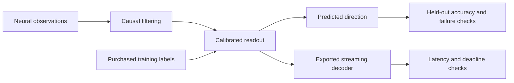
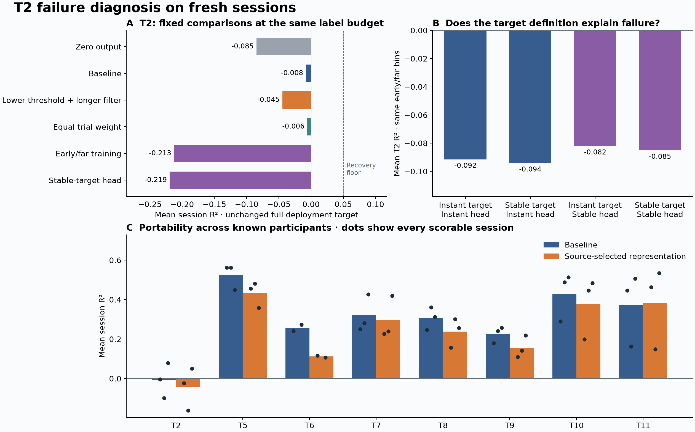

# Low-Latency Neural Decoding

[](https://github.com/logannye/low-latency-neural-decoding/actions/workflows/neural.yml)
[](https://github.com/logannye/low-latency-neural-decoding/actions/workflows/test.yml)

**A brain-computer interface ML testbed for accurate decoding, low calibration burden, and dependable streaming performance.** Built on public human intracortical recordings, with causal streaming prediction, frozen experiments, explicit failure criteria, and reproducible evidence.

## Why this matters

A useful neural interface must keep working as recordings and behavior change. Fast inference is one requirement; equally important are knowing whether a model remains informative, whether more labels will help, and when an update should be rejected. This project builds and tests those decisions together. Its long-term motivation is reliable interfaces that require less supervised setup. Its current evidence comes from offline recordings and replay.

## How it works

Spike counts and spike-band power feed a causal temporal filter and a small regularized direction decoder. Readouts are calibrated separately for each person and session. The broader experiment series tests historical model reuse, daily calibration, confirmation before deployment, and continual recalibration under a label budget.

The latest study investigates a persistently difficult participant, T2. It separates three proposed explanations: the target used for supervision, how calibration trials are weighted, and which neural features are retained. All variants use the same two-minute calibration interval and the same primary held-out scoring mask. A separate stable-target analysis tests whether changing the endpoint changes the conclusion.



Behavioral context and labels remain separate from the feature-only prediction interface. Trials overlapping calibration are excluded from evaluation. Source choices are committed before fresh outcomes are opened; an independent numerical implementation reconstructs exported models, predictions, scoring, uncertainty intervals, and acceptance decisions.

## Latest results

**Positive held-out accuracy across seven comparison participants; no validated T2 recovery.** We evaluated 12 fixed methods on 24 new sessions from eight known participants. Twenty-three sessions were scorable; the remaining recording ends before evaluation and is retained as unavailable. Each session receives a two-minute calibration budget.

The preselected baseline reaches **mean R² 0.303** across all eight participants (participant-bootstrap 95% interval **0.194–0.398**) and **0.348** across the other seven. T2 averages **−0.008**, with session scores **−0.004, −0.098, and 0.079**. It fails the predeclared recovery criterion.

| Fixed T2 comparison | Mean held-out R² | Finding |
|---|---:|---|
| Baseline | −0.008 | Some directional signal, unreliable recovery |
| Equal weight per calibration trial | −0.006 | Little change |
| Lower spike threshold + longer temporal filter | −0.045 | Worse than baseline |
| Train only on early, far-from-target observations | −0.213 | Worse, with far fewer usable labels |
| Train on a stable reference direction | −0.219 | Does not recover the original endpoint |
| Zero-output control | −0.085 | Baseline improves the mean, but not consistently |

Higher R² means better direction prediction; negative values indicate more error than predicting the held-out mean direction. Calibration seconds count recorded observations, rather than elapsed time across recording gaps.

The experiment narrows the failure without assigning a unique cause. Changing to a stable target on the **same early/far evaluation bins** gives R² **−0.085**, versus **−0.094** for the matched original-target model. Thus this target revision is not enough. The combined lower-threshold, longer-filter recipe produces denser observations but worsens accuracy; more activity is not automatically more useful information.

**Trial coverage remains a concrete limitation.** T2's two-minute calibration contains only **7–10 distinct trials**. Reweighting those trials cannot add missing examples, and restricting training to the early/far phase leaves just **4.8–7.2 seconds** of usable observations. These results argue for testing calibration budgets based on diverse trials, alongside a better task/target contract, before assuming that more sophisticated adaptation will solve the problem. They do not establish that T2 has no decodable neural signal.



All seven comparison participants have positive baseline means, ranging from **0.226 to 0.524**. The same decoding recipe is fitted separately in each session; this demonstrates portability across known participants with calibration. It does not establish zero-shot transfer to a new person. The changed cohort and stricter trial exclusions also prevent treating these numbers as a matched improvement over earlier studies.

The source screen selected the existing baseline among neural recipes because the proposed fixes did not consistently improve the exposed development sessions. All eight fixed comparisons and four controls were still evaluated on fresh data. The predeclared recovery decision uses only the preselected recipe; the best-looking fresh result cannot replace it.

Read the **[complete V8 report](neural_experiments/v8/REPORT.md)**, [mechanism diagnosis](neural_experiments/v8/DIAGNOSIS.md), [frozen protocol](neural_experiments/v8/PROTOCOL.md), and [aggregate results](neural_experiments/results/v8-study.json).

## Engineering evidence

The exported source decoder completed **6,000 updates at 50 Hz with zero missed 20 ms deadlines**. Processing p99 was **0.925–0.941 ms**, and release-to-completion p99 was **5.29–5.38 ms**, on macOS ARM64. Its numeric model occupies **6,160 bytes**, with **1,544 bytes** of filter state. Streaming predictions agree with the independent implementation within **7.8 × 10⁻¹⁶**.

These are finite measurements beginning when precomputed neural features are available. They exclude acquisition latency and are not hard real-time guarantees. The selected filter's 200 ms time constant introduces response lag separately from CPU processing time. The source replay is an engineering check; its accuracy is not counted as fresh evidence.

Earlier continual-calibration work also implemented bounded sufficient statistics: **303 KB** of persistent numeric calibration state, plus a **99 KB** input buffer, reproducing reference fits within **1.5 × 10⁻¹⁵** coefficient error. Its [fresh experiment](neural_experiments/v7/REPORT.md) found that more labels and neural-shift triggers did not reliably outperform startup-only calibration. Those failures motivate the present diagnosis.

The repository includes automated leakage, state-reset, export parity, numerical reconstruction, and mutation checks. Raw samples, behavioral traces, prediction arrays, and fitted coefficients remain in ignored local caches. Public evidence includes every selected case and failed criterion. See [runtime evidence](neural_experiments/v8/RUNTIME.md) and [data provenance](neural_experiments/v8/DATA.md).

## Where the evidence ends

The target is cursor-to-target direction, an offline proxy for intention. The recordings do not identify actual intended movement, assistance level, or a unique biological cause of decoder failure. The finite set of unsuccessful fixes cannot establish that T2 is undecodable. T3 remains unresolved from earlier studies.

Fresh sessions come from known participants; transfer to an untouched person is not established. The experiments do not demonstrate closed-loop control, clinical benefit, or how a person would adapt to calibration pauses. Upstream feature-extraction causality and acquisition latency remain unverified. These boundaries apply to every performance claim here.

## Run and explore

Use Python 3.12 and prebuilt scientific libraries:

```sh
python -m pip install --only-binary=:all: -e '.[dev,neural,runtime,benchmark]'
export PYTHONPATH="$PWD/src:$PWD"
export OPENBLAS_NUM_THREADS=1 OMP_NUM_THREADS=1
python -m pytest -q tests/neural_decoder
neural-decode --help
python neural_experiments/replay_demo.py --smoke --output work/replay-smoke.html
```

Synthetic tests and the smoke replay require no neural-data download or Rust build. The [V8 reproduction guide](neural_experiments/v8/README.md) covers source selection, fresh acquisition, assessment, audits, and runtime measurement. The public dataset is [Dryad version 462702](https://doi.org/10.5061/dryad.x0k6djj1h).

Earlier [V3](neural_experiments/v3/REPORT.md), [V4](neural_experiments/v4/REPORT.md), [V5](neural_experiments/v5/REPORT.md), [V6](neural_experiments/v6/REPORT.md), and [V7](neural_experiments/v7/REPORT.md) reports preserve the progression and negative results. Cohorts and scoring windows differ, so their headline means are not matched improvement comparisons. The original image-classification experiment remains available in [CNN_EXPERIMENT.md](CNN_EXPERIMENT.md).
