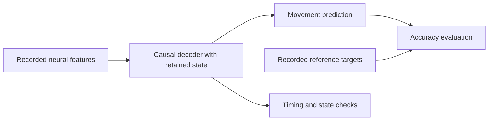

# Low-Latency Neural Decoding

[](https://github.com/logannye/low-latency-neural-decoding/actions/workflows/neural.yml)
[](https://github.com/logannye/low-latency-neural-decoding/actions/workflows/test.yml)

**Predicting movement from recorded neural activity, with experiments on accuracy across recording sessions, calibration effort, and streaming performance.**

This repository contains the models, data pipelines, evaluation code, and deployment experiments for an offline brain-computer interface research project. It uses public human intracortical recordings: measurements of neural activity collected through implanted electrode arrays. The software learns a mapping from those measurements to movement-related targets, then evaluates predictions on data kept out of fitting.

The goal is to understand what it takes for a decoder to remain useful beyond its training session and to execute reliably one observation at a time. The work combines machine learning experiments with streaming implementations, compression checks, timing measurements, and independently implemented numerical audits. All reported results come from recorded data and software replay; the project has not been tested in live human control.

**Start with the [evidence guide](neural_experiments/REVIEWER_GUIDE.md)** for a short tour of the results, or jump to [running the code](#run-without-downloading-neural-recordings).

## The problem

A neural decoder turns patterns of neural activity into an output that a brain-computer interface could use, such as a movement command. Three practical questions guide this project:

- **Accuracy across sessions:** Does a model trained on one set of recordings still make informative predictions on another?
- **Calibration effort:** How much newly labeled data is needed to fit a decoder for a person and session? Can earlier labeled recordings reduce that requirement?
- **Streaming execution:** Can the same model produce correct predictions as observations arrive, with bounded state and measured processing and delivery delays?

These questions are connected. A fast implementation is useful only if its predictions remain informative, and a high average score can hide a participant for whom the decoder fails. The experiments retain unsuccessful models, harmful updates, unavailable cases, and missed deadlines alongside positive results.

## Two study tracks

The repository studies two different prediction tasks. Their datasets, models, and scores should be interpreted separately.

| Track | Inputs and prediction target | Main question |
|---|---|---|
| **FALCON H1: compact model and deployment** | Spike counts from 176 channels, in 20 ms bins, predict seven provider-defined movement-velocity outputs from one participant. | Can a small causal neural network improve later-day accuracy, then preserve decoding quality through streaming execution, export, and compression? |
| **Multiday cursor decoding: calibration and adaptation** | Threshold-crossing counts and spike-band power predict the two-dimensional direction from cursor to target. Studies use multiple recording sessions from known participants. | Can daily calibration and previously labeled recordings improve decoding while reducing the need for fresh labels? |

The H1 model is a **23,367-parameter temporal convolutional network (TCN)**. It uses the current observation and a short history of preceding observations. *Causal* means that prediction does not use future observations. Incremental execution stores the necessary history so it can update one bin at a time. Deployment uses NumPy and ONNX Runtime, which executes models stored in the ONNX model-exchange format.

The V3–V9 cursor studies use causal temporal filtering and regularized linear readouts, with experiments on normalization, historical model reuse, and updates during a session. *Calibration* means fitting a decoder using a designated segment of paired neural features and reference targets. Cursor-to-target direction is a task-based proxy for intention; it is not an independent measurement of what the participant intended to do.

The prediction path is kept separate from the reference targets used to train and evaluate it:



Dataset identities, preprocessing, and target definitions are documented separately for [FALCON H1](neural_experiments/data/README.md) and the [multiday cursor recordings](neural_experiments/v3/DATA.md).

## Main findings

Accuracy is reported using **R²**, a regression score rather than a classification accuracy percentage. A score of 1 indicates perfect predictions; 0 means the same squared error as predicting the evaluation mean; negative values indicate more error than that reference. Each study specifies how outputs, sessions, and participants are weighted. Ridge regression, used in the comparisons below, is linear regression with a penalty that limits the size of its coefficients.

| Experiment | Finding | Scope and interpretation |
|---|---|---|
| [H1 later-day decoding](neural_experiments/FINAL_REPORT.md) | The TCN reached mean R² **0.178**, versus **0.034** for the selected causal ridge baseline. All 21 training-seed/day comparisons favored the TCN. | Seven later recording days from one participant; the headline averages three separately evaluated training seeds. These are local results, not official FALCON benchmark scores. |
| [Final H1 export and compression](neural_experiments/H1_FINAL_CLOSURE_REPORT.md) | The int8 ONNX graph was **61.5% smaller**: 102,884 → 39,641 bytes. The worst seed/day variance-weighted R² loss was **0.00172**, within the fixed 0.005 budget. | All three final models were checked. This validates a fixed conversion on previously assessed recordings; graph size is not process memory or energy use. |
| [Daily calibration, V3](neural_experiments/v3/REPORT.md) | With the same **120 seconds of calibration labels**, the selected decoding procedure reached mean R² **0.258**, versus **0.021** for the original ridge recipe. | 26 new sessions from nine previously studied participants, evaluated after a separate calibration prefix. This depends on fitting a decoder for each session. |
| [Reduced fresh calibration, V4](neural_experiments/v4/REPORT.md) | Historical supervised models plus **30 seconds of fresh labels** reached mean R² **0.245**, versus **0.069** for matched training from scratch. | 23 scored new sessions from eight known participants. The stronger claim that 30 seconds preserves 120-second daily accuracy did not pass its test. |

Later adaptation experiments found important limits. In the [latest calibration study, V9](neural_experiments/v9/REPORT.md), collecting direction-balanced trials did not recover useful decoding for participant T2. Increasing continuous calibration from two to six minutes improved that participant's mean R² from −0.171 to −0.108, but it remained negative. The [V5–V9 reports](neural_experiments/REVIEWER_GUIDE.md) preserve the unsuccessful acceptance, adaptation, and recovery experiments.

These are comparisons within separate studies. Different cohorts and evaluation windows prevent treating successive version numbers as a single accuracy leaderboard, or combining one model's accuracy with another model's latency.

## Streaming and deployment evidence

The final H1 deployment study compares five implementations of the same predetermined model: PyTorch sliding-window float32, incremental NumPy float32, original ONNX float32, a float32 ONNX matrix-layout rewrite, and dynamic-int8 ONNX. The separate layout control matters: **most of the observed fast-replay improvement came from rearranging the matrix computation before quantization**.

The NumPy and int8 implementations each completed a 30-minute replay at 50 updates per second on macOS ARM64:

| Final seed-0 implementation | Later-day R² | Service p99 | Delivery p99 | Missed 20 ms deadlines |
|---|---:|---:|---:|---:|
| NumPy float32 | 0.1771 | 0.450 ms | 9.610 ms | 1 / 90,000 updates |
| ONNX dynamic int8 | 0.1776 | 0.731 ms | 9.449 ms | 5 / 90,000 updates |

**Service time** measures the decoder step. **Delivery time** starts at the scheduled release and includes time waiting to run. The 99th percentile, or **p99**, describes the tail of the measured distribution; it is not a maximum or a guaranteed bound. Both soaks had late results, and the separate short campaign failed the project's 2 ms service-p99 target in two blocks.

Timing uses development recordings; later-day accuracy uses separate recordings with the same model weights. Seed 0 was chosen before measurement, and its scores above differ from the three-seed mean. The measured boundary starts when precomputed neural features are available, excluding acquisition, spike detection, transport, and human feedback. Smaller exported graphs did not establish lower process memory or consistently faster scheduled delivery.

The [deployment report](neural_experiments/H1_FINAL_CLOSURE_REPORT.md) contains every repeat, outlier, resource measurement, and audit receipt, along with file-reset, invalid-input, and checkpoint-continuation checks. A successful checkpoint test establishes numerical resume; it does not establish exactly-once delivery of external commands.

## How the evidence is checked

The experiments separate model selection, prediction, scoring, and verification. Protocols record the data split and acceptance criteria before the associated assessment. The original H1 accuracy study used chronological later-day assessment; subsequent conversion tests reuse those now-exposed recordings. New cursor sessions were selected without using their outcomes, but archive order is not uniformly chronological recording order.

Hashes identify the exact data, models, configurations, and source used in a run. Separate audit implementations reconstruct predictions, scores, graph transformations, and timing summaries, with mutation tests that check whether corrupted evidence is rejected. These are independent implementations within this project, not external clinical validation. Hosted CI checks software and synthetic workflows; it does not rerun the private real-data measurements.

The evidence does **not** establish transfer to a previously unseen person, live closed-loop benefit, clinical effectiveness, physiological intent-response latency, or implant power savings. Weak participants and weak individual outputs remain part of the results.

## Run without downloading neural recordings

Use Python 3.12 and prebuilt dependencies. The following commands assume a fresh POSIX checkout; reuse a compatible environment if you already have one.

```sh
git clone https://github.com/logannye/low-latency-neural-decoding.git
cd low-latency-neural-decoding
python3.12 -m venv .venv
source .venv/bin/activate
python -m pip install --only-binary=:all: -e '.[dev,neural,runtime,benchmark]'

export PYTHONPATH="$PWD:$PWD/src"
export OPENBLAS_NUM_THREADS=1 OMP_NUM_THREADS=1 MKL_NUM_THREADS=1 VECLIB_MAXIMUM_THREADS=1

python -m neural_decoder.cli --help
python neural_experiments/replay_demo.py --smoke --output work/replay-smoke.html
python -m pytest -q tests/neural_decoder
```

Open `work/replay-smoke.html` in a browser to inspect the synthetic replay viewer. Its curves demonstrate the interface, not decoding accuracy. The writer preserves existing outputs, so use a new filename when rerunning it. The tests need no neural-data download; the optional local-cache check skips when its data path is not configured. No Rust build is needed for this workflow.

Real-data reproduction requires obtaining the relevant recordings under their provider terms and following the study-specific preparation, training, and evaluation steps. Recordings, prepared samples, fitted weights, and per-bin predictions/timing traces are excluded from Git. The repository includes code, protocols, aggregate results, and artifact identities.

- [Original H1 reproduction guide](neural_experiments/README.md) and [final-model deployment commands](neural_experiments/H1_FINAL_CLOSURE_REPORT.md#reproduction-commands).
- [Daily calibration reproduction, V3](neural_experiments/v3/README.md) and [history reuse, V4](neural_experiments/v4/README.md).
- [Latest calibration experiment, V9](neural_experiments/v9/README.md), including its data and target contracts.

## Repository map

| Location | Contents |
|---|---|
| [`src/neural_decoder/`](src/neural_decoder/) | Original H1 data loaders, causal models, scoring, streaming execution, and checkpoint support. |
| [`neural_experiments/`](neural_experiments/) | Study runners, later model implementations, protocols, reports, and independent auditors. Versioned directories preserve earlier experiments. |
| [`tests/neural_decoder/`](tests/neural_decoder/) | Numerical, data-boundary, streaming-state, export, and audit-mutation tests. |
| [`neural_experiments/results/`](neural_experiments/results/README.md) | Shareable aggregate evidence and provenance; raw experimental outputs stay in ignored local directories. |

An earlier image-classification and native-kernel experiment is retained in [CNN_EXPERIMENT.md](CNN_EXPERIMENT.md). It is separate from the neural-decoding results described here.
