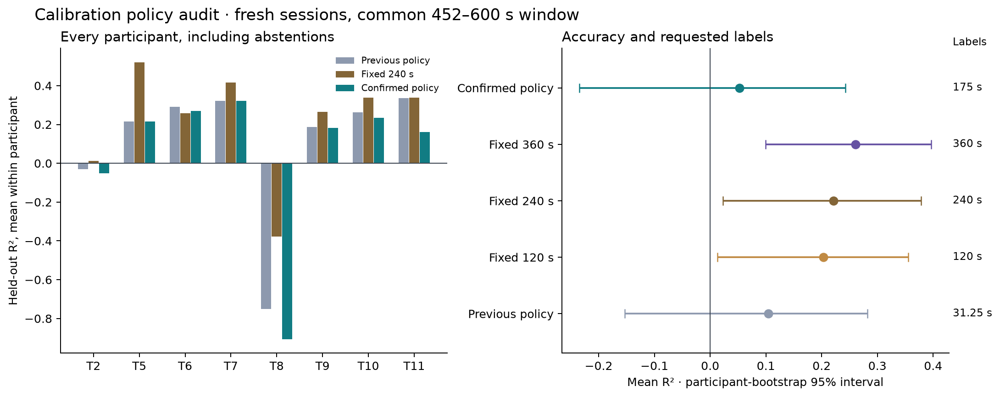

# Low-Latency Neural Decoding

[](https://github.com/logannye/low-latency-neural-decoding/actions/workflows/neural.yml)
[](https://github.com/logannye/low-latency-neural-decoding/actions/workflows/test.yml)

**A BCI decoding testbed that treats accuracy, calibration effort, and streaming
performance as one engineering problem.** Built on public human intracortical
recordings, with chronological holdouts, explicit failure criteria, and
reproducible evidence.

## Why this matters

Fast inference alone does not solve decoder drift. As recordings change, a
useful neural interface must decide whether yesterday's model still works,
whether collecting more labels will help, and when the evidence is too weak to
continue. This project develops and tests those decisions. The longer-term
motivation is dependable interfaces with less supervised setup; the evidence
here comes from offline replay.

## How it works

The system converts spike counts and spike-band power into causal features and
a small regularized decoder. Earlier sessions provide a historical model and
learning curves that show when longer calibration has helped. The controller
then reuses history or collects progressively more current-session labels.

Before deployment, it **freezes the complete model and tests those exact weights
and normalization settings on new confirmation labels**. Each half must beat
simple baseline predictions, and the full window must meet an accuracy threshold.
A failed check requests more
labels; at the budget cap, the controller abstains with zero output. Successful
confirmation deploys the identical exported artifact.

Each person's decoder uses their own recordings and matching electrode layout.
The calibration procedure is evaluated across people. Causal filters and a ridge
readout keep streaming state and per-step work linear in channel count, while
making the fit and exported predictions independently checkable.

## Latest results

On **22 scorable fresh sessions across eight known participants**, fixed
six-minute calibration reached **mean R² 0.261 [95% interval: 0.100, 0.397]**, with
positive participant means for seven of eight people. All methods used the same
late scoring window; two additional selected recordings were too short and
remain in cost accounting. R² measures direction variance explained, with higher
values indicating better prediction.

The new confirmation policy **failed its predeclared success criteria**. It
reduced accepted nonpositive-R² cases from three to two, but retained one
acceptance worse than zero output, lost accuracy, and used more labels. This
experiment is retained as a rejected replacement candidate.

| Procedure | Mean requested labels | Mean held-out R² [95% interval] |
| --- | ---: | --- |
| Previous adaptive policy | 31.25 s | 0.104 [−0.153, 0.282] |
| New confirmation policy | 175 s | 0.053 [−0.234, 0.242] |
| Fixed four-minute calibration | 240 s | 0.221 [0.023, 0.379] |
| Fixed six-minute calibration | 360 s | 0.261 [0.100, 0.397] |

Accuracy averages sessions within participant, then people equally; intervals
resample participants. Costs include training and confirmation windows after a
30-second unlabeled warmup. Abstentions remain in the accuracy calculation.



**T2 remains unresolved:** the new policy accepted one of three sessions and
abstained on two, averaging R² −0.051 after 420 requested label seconds per
session. Across the full cohort it captured only **3 of 10** prespecified
opportunities where longer calibration helped. The main lesson is that passing
a short confirmation window does not reliably predict later decoding, and past
learning curves do not reliably identify the best current-session budget.

## Engineering evidence

The exact T2 model selected by the new policy was replayed on macOS ARM64.
Two 60-second runs paced at 20 ms measured **0.795–0.904 ms processing p99**,
**5.188–5.232 ms release-to-completion p99**, and **zero deadline misses in
6,000 updates**. Numeric model arrays occupy 6,160 bytes and persistent filter
state 3,072 bytes. These are finite feature-ready replay measurements, separate
from decoding quality and any hard real-time guarantee.

The repository passes **789 local tests** (22 optional tests skipped), with
hosted CI and [validation evidence](neural_experiments/results/v6-validation.json).

Protocols and source choices are committed before held-out assessment. A
separate numerical implementation checks fitting, chronological information
access, exported predictions, decisions, uncertainty intervals, and reported
gates. Public evidence includes every selected case and failed acceptance;
raw samples and model coefficients remain in ignored local caches. This is
verification within the project, not external replication.

Read the **[V6 results report](neural_experiments/v6/REPORT.md)**,
[protocol](neural_experiments/v6/PROTOCOL.md),
[data provenance](neural_experiments/v6/DATA.md), and
[aggregate results](neural_experiments/results/v6-study.json).

## Where the evidence ends

The held-out sessions come from known people; transfer to an untouched
participant is not established. The target is cursor-to-target direction, an
offline intention proxy. Closed-loop utility and clinical benefit remain
untested, and short confirmation cannot guarantee reliability under future
drift. T3 remains an unresolved failure from earlier studies.

The controller currently decides startup calibration. Ongoing drift-triggered
recalibration is a next step. Processing begins when neural features are ready;
upstream extraction causality and acquisition latency remain unverified. Causal
smoothing uses 200 or 400 ms time constants; its response lag is distinct from
CPU latency.

## Run and explore

Use Python 3.12 and prebuilt scientific libraries:

```sh
python -m pip install --only-binary=:all: -e '.[dev,neural,runtime,benchmark]'
export PYTHONPATH="$PWD/src:$PWD"
export OPENBLAS_NUM_THREADS=1 OMP_NUM_THREADS=1
python -m pytest -q tests/neural_decoder
neural-decode --help
python neural_experiments/replay_demo.py --smoke --output work/replay-smoke.html
```

Synthetic tests and the smoke replay need no neural-data download or Rust build.
The [reproduction guide](neural_experiments/v6/README.md) covers the complete
real-data study, including independent audits and runtime measurement.

Earlier [V3](neural_experiments/v3/REPORT.md),
[V4](neural_experiments/v4/REPORT.md), and
[V5](neural_experiments/v5/REPORT.md) reports retain the progression from daily
calibration to history reuse and adaptive policies, including negative results.
Their cohorts and scoring windows differ, so headline means are not matched
improvement comparisons. The original image-classification work is preserved in
[CNN_EXPERIMENT.md](CNN_EXPERIMENT.md).
