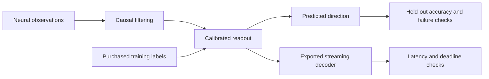
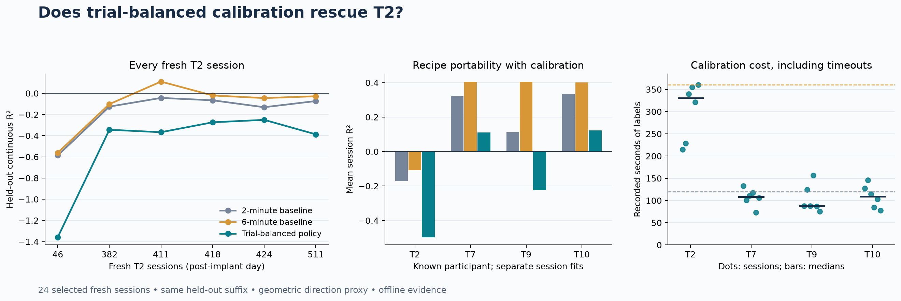

# Low-Latency Neural Decoding

[](https://github.com/logannye/low-latency-neural-decoding/actions/workflows/neural.yml)
[](https://github.com/logannye/low-latency-neural-decoding/actions/workflows/test.yml)

**A brain-computer interface ML testbed for accurate decoding, low calibration burden, and dependable streaming performance.** Built on public human intracortical recordings, with causal streaming prediction, frozen experiments, explicit failure criteria, and reproducible evidence.

## Why this matters

A useful neural interface must keep working as recordings and behavior change. Fast inference is one requirement; equally important are knowing whether a model remains informative, whether more labels will help, and when an update should be rejected. This project builds and tests those decisions together. Its long-term motivation is reliable interfaces that require less supervised setup. Its current evidence comes from offline recordings and replay.

## How it works

Spike counts and spike-band power feed a causal temporal filter and a small regularized direction decoder. Readouts are calibrated separately for each person and session. The broader experiment series tests historical model reuse, daily calibration, confirmation before deployment, and continual recalibration under a label budget.

The latest study asks whether a difficult participant, T2, needs more diverse calibration trials or a better training target. A policy collects at least 24 completed trials with coverage of four direction sectors, subject to a six-minute label budget. A separate trial decoder learns a provider-informed direction averaged over a short movement window. Matched controls isolate direction weighting, target definition and additional calibration time. All methods face the same untouched continuous-decoding interval.



Behavioral context and labels remain separate from the feature-only prediction interface. Trials overlapping calibration are excluded from evaluation. Source choices are committed before fresh outcomes are opened; an independent numerical implementation reconstructs exported models, predictions, scoring, uncertainty intervals, and acceptance decisions.

## Latest results

**Trial-balanced calibration did not rescue T2. More continuous calibration helped, but T2 remains unresolved.** The frozen experiment evaluated 12 methods on **24 previously unopened sessions from four known participants**. Every session was scored, including the calibration timeout; no cases were substituted or removed.

| Participant | 2-minute continuous baseline | 6-minute continuous baseline | Trial-balanced primary |
|---|---:|---:|---:|
| T2 | −0.171 | −0.108 | −0.497 |
| T7 | 0.322 | 0.406 | 0.112 |
| T9 | 0.114 | 0.405 | −0.224 |
| T10 | 0.335 | 0.402 | 0.123 |

Values are mean held-out R² across six sessions per person. Higher is better; negative R² means more error than predicting the held-out mean direction. Label budgets count recorded observations, not wall time across recording gaps. Each decoder is fitted separately within each session.

The positive result on this cohort is a benefit from **additional continuous calibration**. T2 improved on **all six sessions**, with a paired mean gain of **0.063 R²** and session-bootstrap 95% interval **[0.031, 0.103]**. However, only one T2 session became positive, and T2’s overall mean remained slightly below the zero-output control. Across the other three participants, the six-minute baseline reached **mean R² 0.405**, versus **0.257** with two minutes. Longer calibration adds later observations and potentially new trials; this experiment does not isolate label quantity from recency or coverage.

The trial policy reached its coverage quota in **5/6 T2 sessions**, using **303 seconds of labels on average**, yet its neural readout scored below zero in all six. This is a concrete distinction between collecting diverse examples and establishing that a decoder works. A completed quota must not serve as an accuracy acceptance test.



The matched changes to direction weighting and the window-averaged target each changed T2 R² by less than **0.002** on average, with intervals spanning zero. T2 also remained negative on the cleaner trial-window endpoint. These findings narrow the failure: this coverage rule and target revision are insufficient, while the sparse trial readout loses accuracy relative to continuous training. They do not identify a unique neural cause or prove T2 is undecodable.

The source recipe was selected on previously exposed data and committed before fresh conversion. Independent audits reconstructed **1,188 source models and 288 fresh models**, including saved predictions, trial exclusions, calibration costs, uncertainty and both failed recovery gates. All outcomes and controls are retained in the **[V9 report](neural_experiments/v9/REPORT.md)**, [frozen protocol](neural_experiments/v9/PROTOCOL.md), and [aggregate results](neural_experiments/results/v9-study.json).

This is portability of a recipe across known participants with session calibration. It does not demonstrate zero-shot decoding of an untouched person. Archive order fixed the fresh cohort and is not chronological day order; these results should not be presented as a pure future-day forecast or a matched gain over earlier cohorts.

## Engineering evidence

The earlier **V8** exported source decoder completed **6,000 updates at 50 Hz with zero missed 20 ms deadlines**. Processing p99 was **0.925–0.941 ms**, and release-to-completion p99 was **5.29–5.38 ms**, on macOS ARM64. Its numeric model occupies **6,160 bytes**, with **1,544 bytes** of filter state. Streaming predictions agree with the independent implementation within **7.8 × 10⁻¹⁶**.

These are finite measurements beginning when precomputed neural features are available. They exclude acquisition latency and are not hard real-time guarantees. The selected filter's 200 ms time constant introduces response lag separately from CPU processing time. That source replay is an engineering check; its accuracy is not counted as fresh evidence. These are V8 measurements, not new timing claims for the V9 trial decoder.

Earlier continual-calibration work also implemented bounded sufficient statistics: **303 KB** of persistent numeric calibration state, plus a **99 KB** input buffer, reproducing reference fits within **1.5 × 10⁻¹⁵** coefficient error. Its [fresh experiment](neural_experiments/v7/REPORT.md) found that more labels and neural-shift triggers did not reliably outperform startup-only calibration. Those failures motivate testing data coverage and target validity before adding more adaptation machinery.

The repository includes automated leakage, state-reset, export parity, numerical reconstruction, and mutation checks. Raw samples, behavioral traces, prediction arrays, and fitted coefficients remain in ignored local caches. Public evidence includes every selected case and failed criterion. See [runtime evidence](neural_experiments/v8/RUNTIME.md) and [current data provenance](neural_experiments/v9/DATA.md).

## Where the evidence ends

The target is cursor-to-target direction, an offline proxy for intention. The recordings do not identify actual intended movement, assistance level, or a unique biological cause of decoder failure. The finite set of unsuccessful fixes cannot establish that T2 is undecodable. T3 remains unresolved from earlier studies.

Fresh sessions come from known participants; transfer to an untouched person is not established. The experiments do not demonstrate closed-loop control, clinical benefit, or how a person would adapt to calibration pauses. Upstream feature-extraction causality and acquisition latency remain unverified. These boundaries apply to every performance claim here.

## Run and explore

Use Python 3.12 and prebuilt scientific libraries:

```sh
python -m pip install --only-binary=:all: -e '.[dev,neural,runtime,benchmark]'
export PYTHONPATH="$PWD/src:$PWD"
export OPENBLAS_NUM_THREADS=1 OMP_NUM_THREADS=1
python -m pytest -q tests/neural_decoder
neural-decode --help
python neural_experiments/replay_demo.py --smoke --output work/replay-smoke.html
```

Synthetic tests and the smoke replay require no neural-data download or Rust build. The [V9 reproduction guide](neural_experiments/v9/README.md) covers source selection, fresh acquisition, assessment, independent audits, and software validation. The public dataset is [Dryad version 462702](https://doi.org/10.5061/dryad.x0k6djj1h).

Earlier [V3](neural_experiments/v3/REPORT.md), [V4](neural_experiments/v4/REPORT.md), [V5](neural_experiments/v5/REPORT.md), [V6](neural_experiments/v6/REPORT.md), [V7](neural_experiments/v7/REPORT.md), and [V8](neural_experiments/v8/REPORT.md) reports preserve the progression and negative results. Cohorts and scoring windows differ, so their headline means are not matched improvement comparisons. The original image-classification experiment remains available in [CNN_EXPERIMENT.md](CNN_EXPERIMENT.md).
