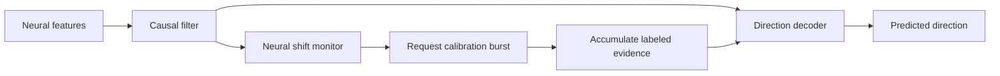
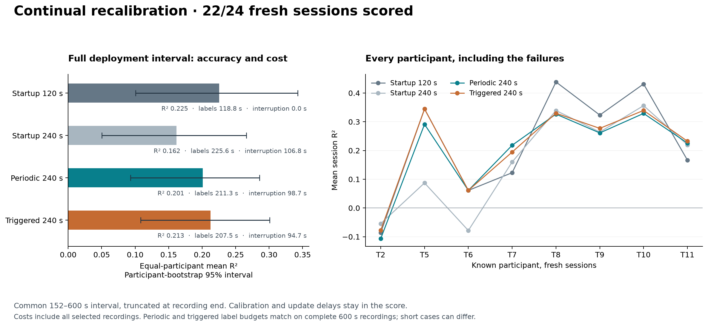

# Low-Latency Neural Decoding

[](https://github.com/logannye/low-latency-neural-decoding/actions/workflows/neural.yml)
[](https://github.com/logannye/low-latency-neural-decoding/actions/workflows/test.yml)

**A brain-computer interface decoding testbed that treats accuracy, calibration effort, and streaming
performance as one engineering problem.** Built on public human intracortical
recordings, with frozen evaluation protocols, explicit failure criteria, and
reproducible evidence.

## Why this matters

Fast inference alone does not solve decoder drift. As recordings change, a
useful neural interface must decide whether yesterday's model still works,
whether collecting more labels will help, and when the evidence is too weak to
continue. This project develops and tests those decisions. The longer-term
motivation is dependable interfaces with less supervised setup; the evidence
here comes from offline replay.

## How it works

Spike counts and spike-band power feed a causal filter and a small regularized
direction decoder. The latest experiment starts with two minutes of labeled
calibration, then collects short feedback bursts throughout the session. It
compares a fixed schedule with requests triggered by changes in neural activity,
giving both the same label budget on complete recordings. Calibration pauses
and update delays count toward the final score.



The trigger sees only past neural observations. Target directions are available
to fitting only during purchased calibration intervals. Updates retain all
acquired evidence; a separate streaming implementation stores sufficient
statistics instead of an ever-growing sample history. It reproduces the
reference fits with memory independent of the number of labels.

Each person's readout uses their own recordings and electrode layout. The
calibration procedure is tested across people. Earlier experiments cover daily
calibration, historical model reuse, and confirmation before deployment; their
failures motivate this focus on sustained performance.

## Latest results

**Continual recalibration did not resolve T2 or improve the cohort average over
two-minute startup calibration.** On 22 scorable fresh sessions across eight
known participants, the startup-only baseline reached **mean R² 0.225**, with
positive participant means for seven of eight people. All three predeclared
continual-recalibration success criteria failed.

| Procedure | Mean available labels | Mean held-out R² [95% interval] |
| --- | ---: | --- |
| Two-minute startup, frozen model | 118.8 s | 0.225 [0.101, 0.343] |
| Four-minute startup, frozen model | 225.6 s | 0.162 [0.050, 0.266] |
| Periodic recalibration | 211.3 s | 0.201 [0.093, 0.286] |
| Neural-shift-triggered recalibration | 207.5 s | 0.213 [0.108, 0.301] |

Scores cover the same deployment interval and include zero output during
calibration. Accuracy averages sessions within participant, then people equally;
intervals resample participants. Costs include all 24 selected recordings,
including two too short to score. Complete recordings give both continual
policies 240 label seconds; shorter recordings can yield different actual costs.
Seconds here count recorded observations. R² measures direction variance
explained, with higher values indicating better prediction.



**T2 remained negative on all three fresh sessions under every tested decoder.**
Its mean R² was −0.086 with startup-only calibration, −0.107 with periodic
updates and −0.078 with triggered updates. Across the cohort, triggering gained
0.012 over periodic updates, but its paired 95% interval [−0.002, 0.027] included
zero. More labels and neural-distribution changes did not reliably translate
into useful sustained decoding in this experiment.

The trigger also behaved mostly like a schedule: **70 of 71 requests came from
mandatory timing rules**, with only one caused by the neural-shift threshold.
This limits the evidence for adaptive detection itself.

An earlier exposed-data screen found that retaining accumulated labels helped
T2, while its recency-weighted candidates failed the original recovery gate.
That motivated this separately locked follow-up through an explicit
[protocol amendment](neural_experiments/v7/CONTINUAL_PROTOCOL.md). The original
failure remains in the [recoverability report](neural_experiments/v7/RECOVERY_REPORT.md).

## Engineering evidence

An audited T2 source model completed two 60-second replays at 50 Hz with
**zero missed 20 ms deadlines across 6,000 updates**. Processing p99 was
**1.29–1.45 ms** and release-to-completion p99 was **5.55–5.56 ms** on macOS ARM64.
These are finite measurements beginning when features are ready.

The streaming calibration path reproduced all five reference fits within
**1.5 × 10⁻¹⁵ coefficient error**. Its persistent numeric calibration state is
**303 KB**, plus a **99 KB** bounded input buffer. State size depends on channel
count, not accumulated label count. The largest measured solve, export and reload
took **1.31 ms**. These component measurements exclude transient solver memory;
they are separate from fresh accuracy and do not establish a hard real-time bound.

The repository passes **1,049 local tests** (22 optional tests skipped), with
hosted CI and [engineering evidence](neural_experiments/v7/ENGINEERING.md).

Protocols and source choices are committed before held-out assessment. A
separate numerical implementation checks fitting, chronological information
access, exported predictions, decisions, uncertainty intervals, and reported
gates. Public evidence includes every selected case and failed acceptance;
raw samples and model coefficients remain in ignored local caches. This is
verification within the project, not external replication.

Read the **[V7 results report](neural_experiments/v7/REPORT.md)**,
[protocol](neural_experiments/v7/CONTINUAL_PROTOCOL.md),
[data provenance](neural_experiments/v7/DATA.md), and
[aggregate results](neural_experiments/results/v7-continual-study.json).

## Where the evidence ends

The held-out sessions come from known people; transfer to an untouched
participant is not established. The target is cursor-to-target direction, an
offline intention proxy. Closed-loop utility and clinical benefit remain
untested, and short confirmation cannot guarantee reliability under future
drift. T3 remains an unresolved failure from earlier studies.

Continual recalibration is evaluated through recorded-data replay. Zero output
during calibration does not simulate how a person would change their behavior.
Upstream feature-extraction causality and acquisition latency remain unverified.
The latest decoder's 200 ms causal smoothing time constant introduces response
lag distinct from CPU latency.

## Run and explore

Use Python 3.12 and prebuilt scientific libraries:

```sh
python -m pip install --only-binary=:all: -e '.[dev,neural,runtime,benchmark]'
export PYTHONPATH="$PWD/src:$PWD"
export OPENBLAS_NUM_THREADS=1 OMP_NUM_THREADS=1
python -m pytest -q tests/neural_decoder
neural-decode --help
python neural_experiments/replay_demo.py --smoke --output work/replay-smoke.html
```

Synthetic tests and the smoke replay need no neural-data download or Rust build.
The [reproduction guide](neural_experiments/v7/README.md) covers recoverability,
source selection, fresh assessment, independent audits, and runtime measurement.

Earlier [V3](neural_experiments/v3/REPORT.md),
[V4](neural_experiments/v4/REPORT.md),
[V5](neural_experiments/v5/REPORT.md), and
[V6](neural_experiments/v6/REPORT.md) reports retain the progression from daily
calibration to history reuse and adaptive policies, including negative results.
Their cohorts and scoring windows differ, so headline means are not matched
improvement comparisons. The original image-classification work is preserved in
[CNN_EXPERIMENT.md](CNN_EXPERIMENT.md).
