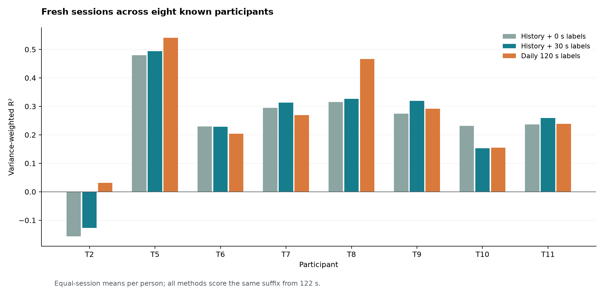
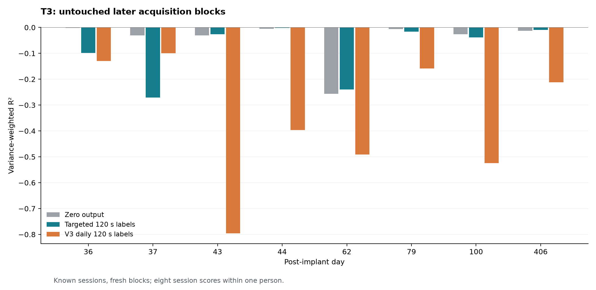

# Low-Latency Neural Decoding

[](https://github.com/logannye/low-latency-neural-decoding/actions/workflows/neural.yml)
[](https://github.com/logannye/low-latency-neural-decoding/actions/workflows/test.yml)

Causal neural decoding under recording drift, limited calibration, and a 20 ms
processing schedule. The project connects decoding accuracy to an explicit
information budget, exported-model correctness, and measured streaming cost.
Protocols, source choices, failures and independent audit receipts are retained.

**Latest result: useful decoding with no fresh daily labels on 23 newly accessed
sessions across eight known participants.** Reusing strictly earlier recordings
with a **30-second unlabeled normalization prefix** gives mean held-out R²
**0.238 [0.105, 0.339]**, with seven of eight participant means positive.
Historical supervised recordings are still required; this is not immediate
zero-data operation or generalization to untouched participants.

Adding 30 seconds of fresh labels reaches **0.245 R² [0.118, 0.352]** and passes
the predeclared useful-accuracy gate. It improves on matched 30-second scratch
training by **+0.176 [0.110, 0.229]**. However, retaining the accuracy of
120-second daily calibration is **not established**: the paired difference is
**−0.029 [−0.083, 0.018]**, which fails the declared −0.05 noninferiority margin.
T2 remains negative under history reuse.



## Accuracy and information budgets

These V4 results use identical scoring windows beginning at 122 seconds, equal
session weight within person, and equal weight across eight people. Intervals
resample participants. The short T6 day1034 recording remains unavailable, with
no replacement. Every requested archive member is accounted for.

| Procedure | Fresh labeled prefix | Mean R² | Positive participant means | Angular error |
| --- | ---: | ---: | ---: | ---: |
| V3 daily refit | 30 s | −0.021 | 4/8 | 67.75° |
| Matched scratch | 30 s | 0.069 | 6/8 | 66.45° |
| Historical prior | **0 s** | **0.238** | **7/8** | **55.00°** |
| Historical prior + adaptation, primary | **30 s** | **0.245** | **7/8** | **53.77°** |
| V3 daily refit | 120 s | 0.275 | 8/8 | 51.41° |
| Historical prior + adaptation, secondary | 120 s | 0.299 | 7/8 | 50.27° |

The history arms use up to three earlier labeled recordings, each capped at
600 seconds. The matched scratch arm has the same current labels, representation,
normalization and regularization, with a zero prior. All history arms require
30 seconds of current unlabeled features, including the zero-fresh-label arm.
The label is an offline cursor-to-target direction proxy, not measured limb
velocity or evidence of closed-loop control or clinical benefit.

## T3: reduced error, failed recovery

T3's exposed-data diagnosis found sparse high-threshold spike counts, unstable
power features, limited directional coverage and overfitting. Lowering the spike
threshold adds many events, but the bounded pilots still failed; weaker
regularization increased training fit while worsening later predictions.

The locked repair combines conservative count features, regularization and
intercept constraints, selected from earlier T3 sessions with a non-T3 fallback
for the earliest session. On untouched later
blocks in eight known T3 recordings, it improves mean R² from **−0.351 to −0.087**,
with paired gain **+0.263 [0.082, 0.456]**. But the zero-output control reaches
**−0.046**, and **none of the eight repaired session scores is positive**.
T3 has not been recovered. Its continuation result is kept separate from the
eight-person new-session cohort.



## Design and verification

The streaming decoder transforms counts with a square root and optional spike-band
power with `log1p`, applies causal exponential smoothing, normalizes using an allowed
prefix, and projects a linear readout to the unit disk. State resets at acquisition
boundaries. Inference receives features only; its persistent state and per-step
arithmetic grow linearly with channel count.

Earlier recordings supply an equal-session ridge prior. A prior-centered fit
adapts that mapping using the allowed current labels; fewer than 50 eligible labels
returns the prior unchanged. A finite grid chooses settings using entire-person
exclusion. History selection enforces strictly earlier acquisition days and the
same electrode layout, regardless of archive order. T3's targeted choice excludes
the query session and later T3 sessions.

Before fresh assessment, **2,560 source models/traces**, nine global choices and
eight T3 choices passed independent verification and were published. The fresh
assessment audited **264 model exports/full traces plus eight unavailable cases**.
Independent checks reconstruct feature recurrences, fit optimality, prefix/history
boundaries, scoring masks, predictions, paired bootstrap intervals and gate decisions.
Maximum assessment replay discrepancy was **1.78 × 10⁻¹⁴**. Sample arrays, models,
coefficients and prediction traces stay local; GitHub contains code and aggregates.

Read the **[V4 report](neural_experiments/v4/REPORT.md)**,
[locked protocol](neural_experiments/v4/PROTOCOL.md),
[T3 diagnosis](neural_experiments/v4/DIAGNOSIS.md),
[data provenance](neural_experiments/v4/DATA.md), and
[reproduction guide](neural_experiments/v4/README.md).
The [complete aggregate results](neural_experiments/results/v4-study.json) retain
all cases, fixed gates, artifact hashes and the independent audit receipt.

## Streaming cost of the exact export

The predefined representative is T2 day187, archive rank10, with 30-second
adaptation. On macOS ARM64, three fast replays measured processing p99 of
**0.020–0.025 ms**. Two 60-second runs paced at 20 ms measured processing p99 of
**0.850–1.078 ms** and release-to-completion p99 of **5.198–5.205 ms**, with
**zero deadline misses in 6,000 paced updates**. The numeric model uses
**6,160 bytes**, with **3,072 bytes** of persistent numeric filter state.

These are feature-ready measurements of one export, not hard real-time guarantees.
Maximum processing time reached 3.84 ms. The 200 ms smoothing filter has about
190 ms mean sample age, a response property separate from CPU latency. The full
batch/stream discrepancy is **7.61 × 10⁻¹⁵**; independent timestamp audit passed.
See the [runtime evidence](neural_experiments/results/v4-runtime.json).

## Earlier evidence

The [V3 study](neural_experiments/v3/REPORT.md) achieved **0.258 mean R²** across
nine known participants and 26 different new sessions with 120-second daily
calibration. Its original ridge comparator reached 0.021; T3 failed, and simply
freezing the old-session mapping also failed. V3 and V4 have different assessment
cohorts, so their headline means are not a matched improvement comparison.

The [V1 report](neural_experiments/FINAL_REPORT.md) and
[V2 report](neural_experiments/v2/REPORT.md) preserve the earlier temporal-network,
H1 and transfer experiments, including negative results. H1 predicts seven
movement coordinates and is not directly comparable to this direction-proxy task.

## Quick start

Use Python 3.12 and prebuilt scientific libraries:

```sh
python -m pip install --only-binary=:all: -e '.[dev,neural,runtime,benchmark]'
export PYTHONPATH="$PWD/src"
export OMP_NUM_THREADS=1
export OPENBLAS_NUM_THREADS=1
python -m pytest -q tests/neural_decoder
neural-decode --help
python neural_experiments/replay_demo.py --smoke --output work/replay-smoke.html
```

Synthetic tests and the smoke replay require no neural-data download. No Rust
or native extension build is required. The [V4 guide](neural_experiments/v4/README.md)
covers acquisition, source selection, one-shot assessment, independent audit,
plots and timing. Raw recordings, prepared arrays, models, coefficients and
sample-level predictions remain in ignored local caches.

Runtime begins when neural features are available. Upstream feature-extraction
causality and acquisition/transport latency remain unverified. Causal smoothing
uses no future samples, but its response time is distinct from CPU latency.

## Earlier image-classification work

The original CNN experiment is preserved in [CNN_EXPERIMENT.md](CNN_EXPERIMENT.md),
with its source, `cnn-*` commands, and
[matched Python/ARM64 results](experiments/baselines/cifar10-matched-cpu-25-v1/README.md).
The repository now focuses on neural decoding, adaptation and streaming inference.
