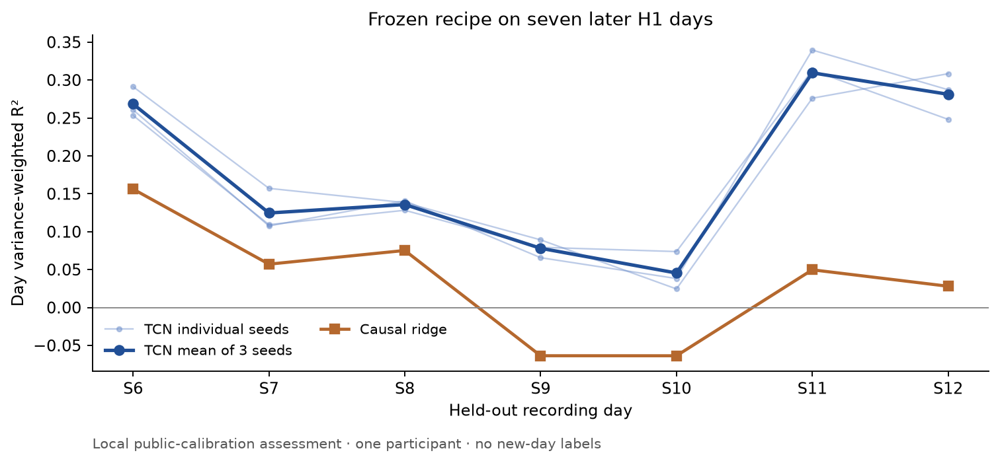

# Low-Latency Neural Decoding

[](https://github.com/logannye/low-latency-neural-decoding/actions/workflows/neural.yml)
[](https://github.com/logannye/low-latency-neural-decoding/actions/workflows/test.yml)

Compact causal movement decoders, tested under recording drift and runtime
constraints. The project connects model quality, controlled adaptation experiments,
and efficient streaming execution through explicit data boundaries and independent
audits.

**Held-out H1 result:** the selected 23,367-parameter TCN averaged **0.178 R²** on
seven later recording days, versus **0.034** for causal ridge, with no new-day
labels. All three seeds beat ridge on every later day. **Systems result:**
incremental NumPy achieved **0.034 ms median fast-replay p99**, about **3.13× lower**
than PyTorch. Its paced p99 was **0.428–0.538 ms**, with no observed deadline miss
in two 60-second blocks on an M4 Max.



These are local evaluations on public FALCON calibration recordings from **one
participant**, not official FALCON leaderboard scores. Timing uses separately
pinned development weights; final quality uses frozen refits. Recorded replay
measures processing from counts being available, not acquisition latency or live
neural control. ONNX recorded one deadline miss; all implementations and repeats
are reported.

## What is here

- Causal FIR/ridge and a small TCN, with three-seed forward-day development and frozen S5/S6–S12 assessments.
- Two bounded research experiments: mean correction did not support its proposed protective bound; fixed training channel dropout passed its keep rule.
- Same-weight PyTorch, incremental NumPy, and ONNX inference; full-step fast/paced measurements, kernel diagnostics, and portable stream checkpoints.
- A separate 0/5/15/30-second supervised calibration curve, explicit int8 quality/runtime tradeoff, and a small second-task transfer check.
- Hash-checked source/data/model identities, independent arithmetic/scoring/timing audits, synthetic tests, and a private recorded-replay demo generator.

Read the **[final report](neural_experiments/FINAL_REPORT.md)** for every final
day/seed, weak outputs, negative results and limitations. The
[protocol](neural_experiments/PROTOCOL.md),
[decision notebook](neural_experiments/NOTEBOOK.md),
[aggregate evidence](neural_experiments/results), and
[one-page narrative](neural_experiments/INTERVIEW_NARRATIVE.md) explain how the
claims were obtained.

## Quick start

Use Python 3.12 and prebuilt scientific libraries:

```sh
python -m pip install --only-binary=:all: -e '.[dev,neural,runtime]'
export PYTHONPATH="$PWD/src"
python -m pytest -q tests/neural_decoder
neural-decode --help
python neural_experiments/replay_demo.py --smoke --output work/replay-smoke.html
```

Synthetic tests and the smoke replay require no neural-data download. Follow the
[reproduction guide](neural_experiments/README.md) after reading the
[provider's data-use terms](neural_experiments/data/README.md). Public artifacts
contain code, protocols, metadata and aggregate results. Raw recordings, prepared
arrays, trained artifacts and sample-level predictions stay in ignored local
caches. No native extension or Rust build is required. The int8 experiment reduced graph
size by 61.47% and fast p99 about 2.15×, but paced rankings varied. The sparse M2
check failed on accuracy; its complete negative result is retained in the report.

## Earlier work

The original image-classification experiment is preserved in
[CNN_EXPERIMENT.md](CNN_EXPERIMENT.md), with its source, `cnn-*` commands, and
[matched Python/ARM64 results](experiments/baselines/cifar10-matched-cpu-25-v1/README.md).
Those measurements belong to the CNN experiment. The repository and Python
package now use `low-latency-neural-decoding` as their primary identity.
