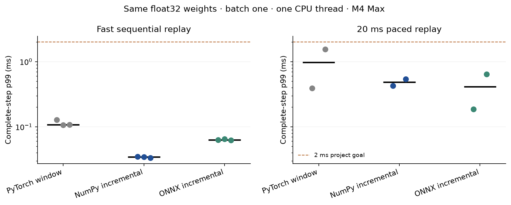
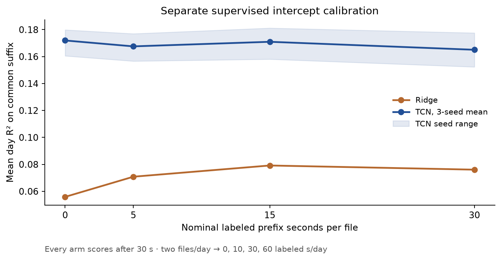

# Neural decoding under recording drift and runtime constraints

The frozen 23,367-parameter TCN achieved mean day R² **0.177583** across seven
later H1 recording days, averaged over three seeds, compared with **0.034146**
for the selected causal ridge baseline. The absolute difference is **0.143438**.
Each of the 21 TCN seed/day scores exceeded the same day's ridge score. This is
a local evaluation on public FALCON calibration recordings from one participant;
it is not an official FALCON score or a live-control result.

The implementation result is separate: incremental NumPy reduced median
fast-replay p99 from **0.107541 ms** for PyTorch to **0.034333 ms**, a **3.13×**
ratio on one M4 Max. NumPy's paced p99 ranged **0.428334–0.537959 ms**, with no
observed deadline miss in its two 60-second blocks. ONNX had one deadline miss.
Paced scheduling delay matters more than the fast kernel ranking suggests.

## Question, model, and information boundary

H1 supplies binned observations from 176 neural channels and seven continuous
movement outputs. A decoder estimates the current output from the current and
preceding counts. Temporal context can make a small nonlinear model useful, while
recording changes can shift the relationship between observations and behavior.
Changing neural averages alone cannot identify whether the change came from the
recording, the behavior distribution, or another source.

The ridge baseline applies a normalized 12-tap exponential FIR, followed by
training-only channel centering/scaling and one filtered-bin linear regression.
The selected regularization is 0.1. The TCN uses three width 32, kernel 3 causal
convolutions with dilations 1/2/4, ReLU, and a seven-output linear head. Its
15-bin receptive field spans 300 ms, with no future lookahead. Inputs and targets
use training-derived transforms; predictions are returned in source output units.
The seven names are source labels, not an inferred anatomical interpretation.

All primary decoders reset at each provider file and advance on every bin,
including unscored bins. Trials do not reset state. Only counts enter inference;
labels and score masks are joined by the evaluator after prediction. Training
uses supplied masks, fixed 20 epochs, final-epoch weights, Adam learning rate 0.001,
256-bin loss chunks with 14 preceding context bins, batch 16, and seeds 0/1/2.
Training-only channel dropout p=0.1 is held constant across each chunk's time.
No final labels select a seed, epoch, architecture, adaptation rule, or threshold.

## Development decisions

Development used S0–S1→S2, S0–S2→S3, S0–S3→S4. The six-setting ridge grid
selected history 1/lambda 0.1, averaging 0.052625. The original TCN averaged 0.160722.
S2 was poor and seed-dependent. Full baseline and initial TCN tables remain in
[the development report](REPORT.md).

The first hypothesis tested the selected ridge decoder with source-anchored mean
correction using a 30 second EMA,
frozen weights/variance, and predict-before-update ordering. Ordinary EMA raised
real development mean R² to 0.142009; bounded caps 0.25/0.5/1.0 produced
0.086526/0.104685/0.123421. All improved the real days. However, ordinary EMA
also harmed no day in the prespecified movement-mixture diagnostic, so no bound
could demonstrate the required strictly smaller harm. The positive observation
offset was not uniformly damaging either. The locked rule retained frozen
normalization. This is an unsupported protective rationale, not evidence that
all adaptation is ineffective. See [ADAPTATION.md](ADAPTATION.md).

The second and final hypothesis tested one p=0.1 channel-dropout configuration,
keeping all other TCN settings fixed. It raised the three-seed mean to 0.172153,
an absolute 0.011431 gain. Seed-average day gains were 0.010648/0.005737/0.017909,
meeting the locked gain and day-harm rules. Individual seed/day harms remain:
seed 1/S2 lost 0.059171 and seed 2/S3 lost 0.029548. The selected recipe retains all
three seeds. Only two nonlinear configurations were tested, with no subsequent
search. See [AUGMENTATION.md](AUGMENTATION.md).

## Frozen assessment

The early model set was fitted on S0–S4, then bound to committed source,
configuration, data metadata, model hashes and primary metrics before opening S5.
S5 was scored once. The identical recipe was then refitted on S0–S5 and bound
to a child freeze before opening S6–S12. The child verifies its parent's recipe
and implementation hashes. No result from S5 changed the recipe.

| Assessment | Constant | Ridge | TCN seed 0 | TCN seed 1 | TCN seed 2 | TCN seed mean |
|---|---:|---:|---:|---:|---:|---:|
| S5, train S0–S4 | -0.000038 | 0.162497 | 0.282756 | 0.240993 | 0.220897 | 0.248215 |
| S6–S12, train S0–S5 | -0.001099 | 0.034146 | 0.177086 | 0.172127 | 0.183536 | 0.177583 |

The later assessment contains 14 files, 34,490 bins and 33,613 scored bins:
689.80 nominal seconds total, 672.26 scored seconds. There are two files per day,
roughly 46–54 seconds each. Provider date stamps span 14 days from S6 to S12;
the full S0–S12 metadata spans 39 days. These are short released intervals from
one participant, not continuous weeks of independent observations. S5 contributes
only one independent early assessment day. Minival was not used for H1 evidence.

| Day | Ridge | TCN seed 0 | TCN seed 1 | TCN seed 2 | TCN mean | Mean minus ridge |
|---|---:|---:|---:|---:|---:|---:|
| S6 | 0.156168 | 0.260588 | 0.253305 | 0.291203 | 0.268365 | +0.112197 |
| S7 | 0.057152 | 0.107552 | 0.109253 | 0.157154 | 0.124653 | +0.067501 |
| S8 | 0.075218 | 0.140838 | 0.128235 | 0.138320 | 0.135798 | +0.060580 |
| S9 | -0.063618 | 0.065687 | 0.079389 | 0.089221 | 0.078099 | +0.141717 |
| S10 | -0.063656 | 0.038209 | 0.073774 | 0.024470 | 0.045484 | +0.109140 |
| S11 | 0.049724 | 0.339554 | 0.312829 | 0.276036 | 0.309473 | +0.259749 |
| S12 | 0.028031 | 0.287177 | 0.248104 | 0.308350 | 0.281210 | +0.253179 |

The TCN seed-level mean population SD is 0.004671 on later days; this is seed
variation, not uncertainty over participants. Population SD across days using the pinned scoring convention
is 0.109109/0.089692/0.101886 for TCN seeds 0/1/2, and 0.072218 for ridge. Full
per-output/day metrics and scored/unscored counts are in [final-later.json](results/final-later.json).
The table below averages each output's day R², and for TCN also averages seeds;
it is not the variance-weighted primary metric. `tz` remains a weak output.

| Source output | Ridge mean output R² | TCN mean output R² |
|---|---:|---:|
| tx | -0.011784 | 0.047456 |
| ty | -0.016552 | 0.051523 |
| tz | -0.031911 | -0.071075 |
| rx | 0.121465 | 0.196399 |
| g1 | 0.049324 | 0.213154 |
| g2 | -0.026716 | 0.143911 |
| g3 | 0.056652 | 0.193709 |

## Same-weight runtime experiment

Measurements used Apple M4 Max, 128 GiB RAM, macOS 26.2, CPU execution, one numeric
thread, batch one, float32 and fixed input order. The preselected original TCN
seed 0/S4 development artifact is used for all three runtime implementations;
its exact identity is in the runtime config. Final quality uses the separate
frozen dropout refits. Timing numbers must not be silently attributed to those
other weight files, another device, an implant, or a closed-loop system.

Before timing, every full development trace passed numerical and score parity
against a whole-file reference. Fast replay uses all 11 development files,
112,488 bins per repeat, in three counterbalanced implementation orders. Paced
replay uses two 60 second blocks per implementation in reversed order. Every block
has a declared 500-bin warmup followed by reset. Complete-step service includes
input transforms, validation, model computation and all state work. These frozen
models perform no adaptation after returning a prediction. Raw monotonic release,
start, ready, completion and deadline timestamps are retained for every bin.

| Implementation | Fast p99 range, ms | Paced p99 range, ms | Paced deadline misses / bins |
|---|---:|---:|---:|
| PyTorch window | 0.106917–0.128130 | 0.391084–1.557250 | 0 / 6,002 |
| NumPy incremental | 0.033416–0.034709 | 0.428334–0.537959 | 0 / 6,002 |
| ONNX incremental | 0.062209–0.065208 | 0.185500–0.643500 | 1 / 6,002 |

All blocks met the provisional 2 ms p99 service goal, but a percentile is not a
hard deadline guarantee. The ONNX miss had 31.224541 ms service time. Paced queue
p99 was about 4.85–4.94 ms; release-to-completion p99 was about 5.05–5.86 ms. NumPy
won every fast-repeat comparison, while paced rankings varied. Background host
scheduling and wake-up behavior remain part of this measured desktop environment;
these observations do not isolate the cause of the ONNX outlier.

The numeric model arrays occupy 94,940 bytes. Original TCNStream allocates 14,464 bytes
of persistent numeric state for its window and ring buffers; ONNX histories use
2,944 bytes and its graph is 102,884 bytes. RSS and CPU are recorded for the complete
measurement process, which also retains reference/data arrays and runtime
libraries; they are not isolated deployment RSS or power measurements. Constructor,
reset, environment, system load and per-repeat values are retained in
[runtime.json](results/runtime.json). The kernel microbenchmark explains repeated
first-layer work and remains separate from full-step evidence.

## Separate supervised calibration curve

After primary scoring, a separate job fit only a seven-output intercept correction
from scored labels within each file's first 0/5/15/30 seconds. Every arm ingested the
same preceding neural observations and scored the identical suffix beginning at
30 seconds. No later-file label calibrated an earlier file. The source model and
its filter state were otherwise unchanged.

| Nominal labeled seconds/file | Nominal seconds/day | Ridge suffix R² | TCN mean suffix R² |
|---|---:|---:|---:|
| 0 | 0 | 0.055885 | 0.171955 |
| 5 | 10 | 0.070850 | 0.167578 |
| 15 | 30 | 0.079179 | 0.170975 |
| 30 | 60 | 0.076083 | 0.165053 |

Actual scored prefix-label seconds across all 14 files were 0/66.32/204.00/408.38,
versus nominal 0/70/210/420 seconds. The common suffix is shorter than the primary
full-file assessment, so its zero-label scores differ. Intercept calibration
helped ridge but did not improve the TCN mean at any tested budget. This does not
show that labels are useless or that every calibration method would fail; it
bounds the result to this fixed correction and these short prefix/suffix pairs.
All per-file accounting is in [calibration.json](results/calibration.json).

## Compression and second task

A separately prespecified dynamic-int8 conversion passed its development quality
gate across all nine dropout-model seed/fold combinations: mean R² change
was +0.001731 and the worst change was -0.000617, within the -0.005 limit. The
exported graph shrank from 102,884 to 39,641 bytes, a 61.47% reduction. With the
same dropout seed 0/S4 artifact and ONNX CPU runtime, fast p99 was
0.025292–0.025333 ms for int8 versus 0.054339–0.054709 ms for float32, about
2.15× lower for the complete conversion, which includes a validated matrix-layout
rewrite. The rewritten float32 graph was not timed separately, so this does not
isolate int8 arithmetic. Paced p99 ranges overlapped and the ranking reversed between repeats:
0.899709–0.989292 ms for int8 versus 0.859958–1.098208 ms for float32. Neither
arm missed a deadline in 6,002 paced bins. Float32 remains the primary final model;
compressed final-day accuracy was not assessed. These weights differ from the
primary same-weight runtime campaign. See [COMPRESSION.md](COMPRESSION.md).

The bounded second-task study applied the fixed H1 ridge recipe to seven complete
FALCON M2 minival files from one rhesus macaque. It tested 96 input channels and
two outputs, using four training trials (302 bins, 6.04 seconds) and ten evaluation
trials (709 bins) across three later days. Mean day R² was **-13.497285** for ridge
versus **-0.034258** for the constant baseline. This is a clear quality failure
under the sparse training setup. Independent raw-HDF5 preparation, convolution,
sklearn refitting and scoring agreed, so numerical portability passed while useful
quality transfer did not. There was no retuning or expanded data search. The
sample intervals, target units and loader timing differ from H1; no H1
fitted weights or TCN were tested on M2. See
[M2_REVIEW.md](M2_REVIEW.md) and the [locked plan](SECOND_TASK_PLAN.md).

## Validation, provenance, and limits

Independent audits reconstructed 10 early and 70 later full prediction traces
using whole-file Torch or independent NumPy FIR arithmetic, and recomputed day
scores with sklearn. The later maximum trace difference was 1.77e-08. Calibration
reconstruction matched 224 traces exactly. The runtime audit reconstructed every
metric in 15 blocks and checked measured predictions against independent full-file
convolution, with maximum difference 2.61e-08. Tests cover future perturbation,
label/mask separation, file resets and trial continuity, chunk partition, sequence failure,
startup padding, source/model identity, bounded state, snapshot restore and
calibration suffix equality. Hosted checks validate Python packaging and synthetic
contracts; M4 runtime measurements are local, not Linux-CI performance claims.
The final local Python regression suite passed 217 tests on macOS/Python 3.12.13;
Ruff lint and formatting checks passed. Hosted final-revision checks and merge
validation are recorded in [PR #2](https://github.com/logannye/low-latency-neural-decoding/pull/2).

The early freeze and primary runtime record source revision
`8d7220e500ee543b1a8cf19f697848a292f761f4`; the later freeze records
`4f30a3dc076c93292408ce663776cf8e131a9ce4`, with identical frozen implementation
and recipe hashes. The exact early freeze digest is
`471c01b3fdc030c432b61c8188641c110b56f97aeb25ea64f5455312849a1fff`; later is
`fd458c649b2af3c78e90ab2298821b2e28a1dc38011c7cc5ee3b29ef19dcea1c`.
Documentation/audit-only commits do not transfer acceptance to altered decoder
code: the gate compares frozen implementation bytes against both Git and disk.
The [evidence index](results/README.md) links aggregate audit receipts and run
provenance. Public freezes and aggregate results accompany the code; raw recordings, derived
sample arrays, trained artifacts and private replay remain local under the data-use
terms. Reproductions create their own new model hashes and freeze decisions.

The evidence supports a useful compact open-loop decoder on this participant's
released recordings and fast counts-ready streaming on this machine. It does
not establish cross-participant transfer, causal identification of recording
drift, real-time human control, biological adaptation, clinical benefit, acquisition
or wireless latency, implant power savings, or general decoder superiority.

Native kernels were conditional on a worthwhile profiled bottleneck. The existing
Python/prebuilt-runtime implementations met the service goal, so no new native
kernel or local native build was justified. Portable runtime snapshots were
implemented and tested; full optimizer/training resume was unnecessary for the
short fixed 20 epoch runs. Hidden-service submission remains separate: no official
score is claimed, and local EvalAI authentication is unavailable.
