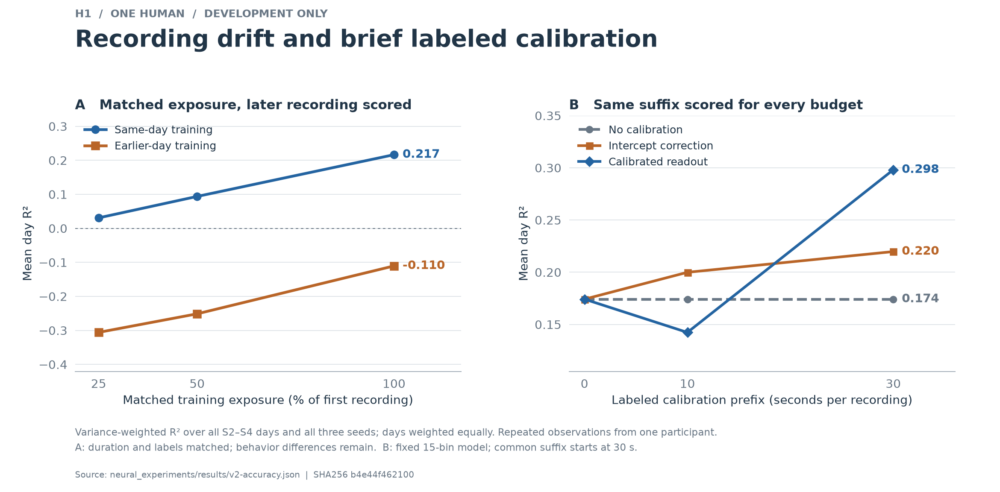
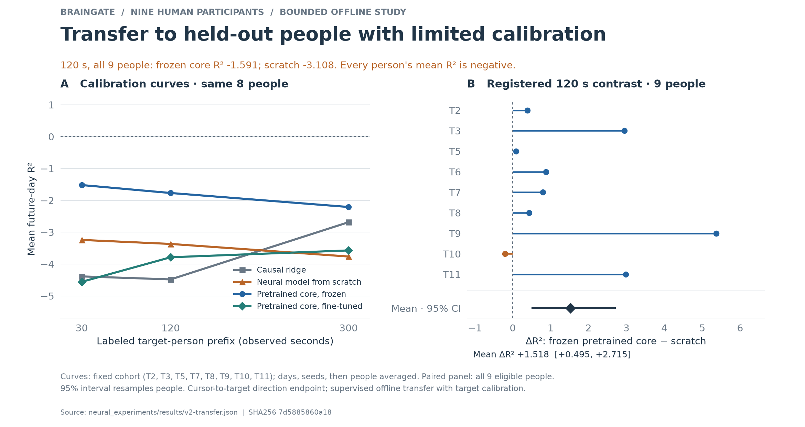
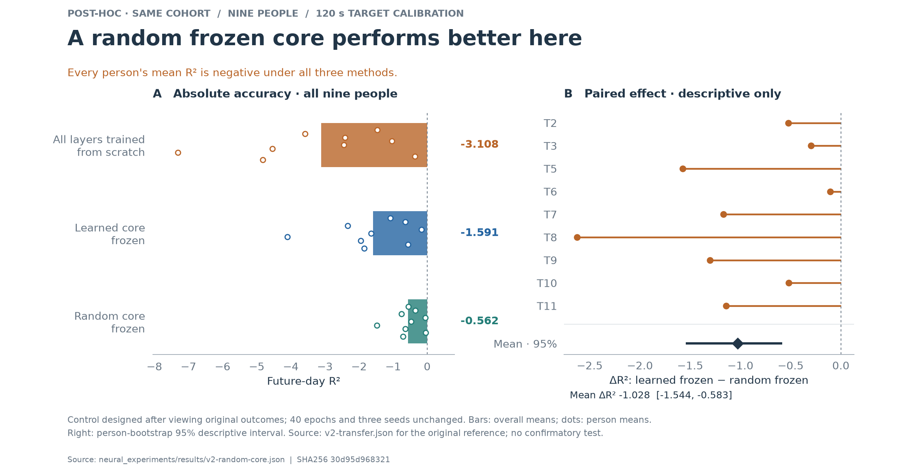
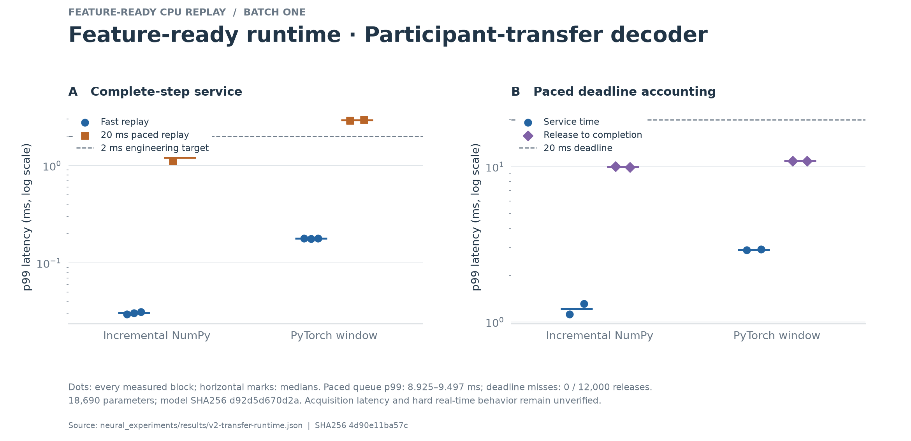

# Accuracy, calibration, and participant transfer

This study extends the original one-participant decoder with three distinct
tests: controlled H1 accuracy experiments, supervised adaptation to an excluded
person, and execution of the exact exported artifacts under a 20 ms release
schedule. The machine-readable plans were fixed and hash-locked before their
respective fits. The [transfer protocol](PROTOCOL.md) and source-budget amendment
were also committed before transfer fitting; the H1 plan entered Git after its
local execution had begun. The original H1 later-day results remain frozen.

## Why these experiments

A neural channel is an observation of a local population, not a stable semantic
feature shared by different implants. Recording drift can change the mapping
from those observations to movement. Adding model capacity can address temporal
structure, but does not supply missing information about a new recording's
mapping. We therefore separated context length and loss weighting from
supervised recalibration, then tested whether temporal features learned from
other people reduce the target person's calibration requirement.

The H1 study predicts seven movement coordinates from 176 channels. The new
BrainGate cohort predicts two-dimensional cursor-to-target direction from 96
or 192 channels. The latter is an intention proxy during movement attempts.
These endpoints and cohorts differ; their absolute R² values are not a common
leaderboard, and H1 is excluded from the transfer source pool.

## H1: adaptation helped; larger context did not pass selection

The controlled forward-day comparison used S0–S4, three seeds, a common training
burn-in, and a nested source-validation choice of 40 epochs. Its RF15 baseline
averaged 0.159170 R². RF63 averaged 0.041082; source-unit loss weighting produced
0.146591 for RF15 and −0.023503 for RF63. None passed the locked gain/day-harm
gate. All arms and negative outcomes are retained in [the accuracy report](ACCURACY.md).
This V2 training procedure differs from the original V1 baseline, so these
numbers do not imply a regression in the frozen V1 model.

With neural duration and eligible label count matched, same-day prefix training
beat older-day training in 26 of 27 comparisons on the same disjoint last file.
At full prefix exposure, the means were 0.216539 versus −0.110433. Behavior
coverage and reset counts were not matched, so this supports distribution shift
as an engineering concern without isolating its biological cause.

The selected RF15 model's 30-second ridge readout correction raised common-suffix
R² from **0.174224 to 0.298100**, an absolute **0.123876** improvement. It beat
both unadapted and intercept-only decoding in all nine day/seed comparisons.
Ten seconds was insufficient for the same fixed correction: mean R² declined
to 0.142394. These are development results from one participant, not new
untouched-test evidence or zero-shot adaptation.

The independent H1 audit verified 1,689 artifacts and reproduced 422 score
records with exact numerical agreement. A post-fit algebraic composition folds
the selected 30-second correction into the existing linear head. It preserves
23,367 parameters, the backbone, and the streaming operation count. On the
selected S4/seed-0 file, suffix prediction error after composition was at most
1.01 × 10⁻⁸ and R² changed by less than 9 × 10⁻¹⁰. That single artifact's score
is distinct from the multi-day/seed calibration average.

## Participant study design

The fixed cohort contains nine decoding participants from Dryad version 462702.
The first six regular decoding-session MAT members in each archive are selected
without model outcomes, retaining short and zero-go sessions, then sorted by
numeric implant day. This is a bounded convenience
sample, not the entire 729-session release. All selected sessions, missing
budgets, empty evaluation sets, and unsuccessful fits must remain visible.
The retained cohort contains 27.9244 hours of observed bins; the fixed
600-second session caps expose 8.2320 hours to this experiment. Future-day
evaluation covers 6.9076 hours across 45 sessions, including 1,080,377 scored
bins. These are durations of distinct input windows, not multiplied by models
or seeds. T6's earliest session lasts 224.46 seconds: its 30/120-second future-day
comparisons remain eligible, its 300-second budget is unavailable, and it has
no common same-session suffix. Full accounting is in [DATA.md](DATA.md).
Later-session gaps range from 1 to 1,056 post-implant days after the calibration
session. Archive order therefore creates a demanding, uneven horizon; these
are not uniformly next-day predictions.

Each outer fold excludes a complete person from source optimization and source
checkpoint validation. The other people's earlier selected days train
participant-specific input adapters and heads around one shared residual TCN.
Their last selected days choose among the fixed 600/1,200/2,400-step checkpoints.
The 2,400-step budget was committed before transfer fitting as a source-coverage
amendment; no target result informed it.

The excluded person receives a fresh input adapter and head. Frozen-core
pretraining, full fine-tuning, the same neural architecture from scratch, and
causal ridge receive identical 30/120/300-second prefixes and effective label
rows. Normalization uses only the permitted prefix. Every later day is evaluated
without further updates. The first-session suffix begins after 300 seconds for
all feasible budgets. Observed-bin seconds exclude acquisition gaps; they are
not a verified wall-clock calibration duration.

The primary endpoint is equal-person mean future-day R², with days weighted
equally within people and three model seeds averaged before computing each
person's effect. The primary contrast is frozen core minus scratch at 120
seconds. Participant bootstrap intervals and exact sign-flip statistics use
people as the replication unit. Other method/budget comparisons are descriptive.

## Participant results: relative benefit, poor absolute accuracy

The run completed 27 source fits and 260 target fits in 483.4 seconds. Ten
planned cases are unavailable because T6 cannot supply a 300-second prefix.
The independent audit verified all 54 selected source members, 27 source cores,
260 models, and 1,560 saved prediction traces, reconstructing the scores and
participant-level summaries. The full [public aggregate](../results/v2-transfer.json)
includes every model, day, coordinate, calibration count, and case disposition.

At the primary 120-second budget, frozen-core transfer averaged **−1.590746 R²**
versus **−3.108407** from scratch. The paired improvement was **+1.517661**,
with a participant-bootstrap 95% interval **[+0.494858, +2.714568]**, and exact
two-sided sign-flip p = **0.01171875**. Eight of nine people improved. The locked
relative-gain target was met, but every person's frozen-core future-day mean
remained negative. Negative R² means greater squared error than the per-day
coordinate means used by the scoring denominator; those hindsight means are
not a separately deployable baseline. These results do **not** establish useful
cross-person decoding accuracy.

The primary contrast also combines two changes: source-learned weights and
freezing most parameters. Scratch updates the entire network, whereas the
frozen arm updates only its adapter and head. The primary result alone cannot
attribute its gain to learned source information rather than regularization
from freezing. An additional random-frozen-core control was therefore specified
after observing these outcomes; it is explicitly exploratory and cannot supply
a new confirmatory claim on the same cohort.

| Person | Scratch R² | Frozen core R² | Paired difference |
| --- | ---: | ---: | ---: |
| T2 | −1.4625 | −1.0784 | +0.3841 |
| T3 | −3.5862 | −0.6415 | +2.9447 |
| T5 | −2.4159 | −2.3330 | +0.0828 |
| T6 | −1.0374 | −0.1645 | +0.8729 |
| T7 | −2.4395 | −1.6419 | +0.7975 |
| T8 | −4.5377 | −4.1052 | +0.4325 |
| T9 | −7.3131 | −1.9454 | +5.3677 |
| T10 | −0.3583 | −0.5603 | −0.2019 |
| T11 | −4.8251 | −1.8464 | +2.9787 |

Each entry averages three seeds and five future days, giving days equal weight.
R² has no finite lower bound, so large improvements from severely negative
baselines must not be presented as percentage accuracy gains. The interval and
sign-flip analysis concern this small, nonrepresentative cohort and their
statistical assumptions; they do not establish population or clinical effects.

| Prefix | People | Ridge | Scratch | Frozen core | Fine-tuning |
| --- | ---: | ---: | ---: | ---: | ---: |
| 30 s | 9 | −3.996641 | −3.003307 | −1.372987 | −4.158828 |
| 120 s | 9 | −4.040712 | −3.108407 | −1.590746 | −3.546172 |
| 300 s | 8 | −2.684985 | −3.762541 | −2.207934 | −3.571046 |

These secondary future-day comparisons include every feasible person at each
budget. The figure's budget curves instead hold the same eight-person cohort
fixed across all budgets, so missing T6 does not masquerade as a budget effect.
Its primary-effect panel retains all nine people. Additional target labels and
fine-tuning did not reliably improve this fixed recipe; 30 seconds having a
better aggregate does not replace the prespecified 120-second primary endpoint.

Same-session 120-second frozen-core means were positive in T7, T8, and T10,
but the other five eligible people were negative, and T6 had no common suffix.
The future-day failure therefore cannot be assigned solely to the number of
participants. The current experiment does not isolate limited behavior coverage,
normalization sensitivity, optimization, or inter-day drift as its cause.
A subsequent study should diagnose those possibilities using source participants
and reserve fresh participant/session evidence before revising the recipe.
The current held-out results must not become both the tuning set and the claimed
confirmatory test.

## Exploratory control: random features outperformed learned features

After the primary outcomes were visible, the separate
[random-core plan](random_core_plan.json) was committed in `8a21df3` before
its 27 new fits. It fixes one arm, the 120-second prefix, all nine people and
three seeds, and the original 40-epoch procedure. The random core exactly
matches the corresponding scratch initialization, including channel-dependent
random-number consumption. Only adapter and head train, matching the learned
frozen-core arm's trainable parameters. No target-dependent search or refit of
the original arms occurred.

The random frozen core averaged **−0.562298 future-day R²**, compared with
**−1.590746** for the learned frozen core and **−3.108407** for scratch.
Random frozen features outperformed learned frozen features in **all nine
people**. Learned-minus-random mean difference was **−1.028448**, with a
**descriptive** person-bootstrap 95% interval **[−1.543836, −0.582877]**.
Every person's random-core mean remained negative. This interval is exploratory
because the control was chosen after seeing the primary results; there is no
new confirmatory p value or success gate.

The primary frozen-versus-scratch improvement therefore cannot be credited to
learned source information here. Freezing a random feature map gives a stronger
relative result under the same calibration procedure. This supports freezing
and limited trainable capacity as practical controls and weakens the proposed
pretraining explanation, while leaving the causes of poor absolute accuracy
unresolved. Useful cross-person decoding remains unestablished.

The control completed in 18.94 seconds, including 11.82 seconds of summed
target-model fitting. Its verification pass checked all 27 models and 162
traces, initial/final core equality, prefix statistics, common masks, complete
seed pairing, hashes, and the original learned-model references. The runner and
verification share a new source file and aggregation helpers; numerical scores
use the existing independently implemented scikit-learn reference. This is
shared-source verification, not a second independently implemented optimizer
or decoder. Full details are in [v2-random-core.json](../results/v2-random-core.json).

On the common same-session suffix, the eight eligible people's means were
0.023045 for random frozen features and −0.079275 for learned frozen features.
The descriptive learned-minus-random interval was [−0.240711, +0.022938]. This
secondary result concerns a different evaluation horizon and does not replace
the negative future-day endpoint.

## Same-artifact H1 runtime

The composed H1 model retains 23,367 parameters and 93,468 bytes of numeric
weights. Full-trace maximum absolute disagreement was 1.863 × 10⁻⁸ for NumPy
incremental execution and 3.725 × 10⁻⁹ for the PyTorch window reference. Three
fast repeats used alternating order; two 60-second paced blocks per implementation
released observations every 20 ms, after a 500-bin warmup and reset.

| Implementation | Median fast p99 | Paced service p99 | Paced release-to-completion p99 | Paced misses |
| --- | ---: | ---: | ---: | ---: |
| NumPy incremental | 0.028917 ms | 0.871657–0.873307 ms | 9.896972–9.954031 ms | 0 / 6,000 |
| PyTorch window | 0.090229 ms | 2.253121–2.462055 ms | 10.485641–10.497259 ms | 0 / 6,000 |

Incremental NumPy's median fast p99 is 3.12× lower, and both paced service p99s
meet the 2 ms engineering target. PyTorch does not meet that service target,
although neither implementation misses a 20 ms deadline in these blocks.
Numeric streaming caches occupy 3,904 bytes for NumPy and 10,560 bytes for the
window reference. This excludes weights, affine transforms, Python objects,
temporary allocations, and process RSS.

Scheduling dominates the measured end-to-end result: NumPy queue p99 is
9.493–9.596 ms, despite submillisecond service p99. Adding component p99s is not
the definition of total p99; release-to-completion is measured directly from
each timestamp pair. The ordinary sleep-based replay scheduler therefore does
not demonstrate submillisecond end-to-end latency. The full
[timing aggregate](../results/v2-h1-runtime.json) retains every block, maximum,
queue statistic, deadline count, initialization measurement, and audit identity.

The first H1 timing attempt stopped at repository-relative path validation
before recording any timing block, because the existing cache was an external
symlink. The retained second attempt used a byte-identical local feature copy,
verified by SHA256. Neither the model nor feature values changed. Its independent
timestamp audit passed all ten blocks; that auditor checks timestamp arithmetic
and artifact identity, while model parity is a separate executed check.

## Same-artifact transfer runtime

The prespecified representative is T2, frozen core, 120 seconds, seed 0. It is
the first eligible person in plan order, not the most accurate or fastest model.
Its SHA256 is `d92d5d670d2a3c8ed27e3cf540c0cdaee21512b4b7cdc0f4641444863716f0e4`.
It has 18,690 parameters and 74,760 numeric weight bytes. Across the complete
30,000-bin timing workload, maximum absolute disagreement was 5.960 × 10⁻⁷
for NumPy and 4.768 × 10⁻⁷ for the PyTorch window reference.

| Implementation | Median fast p99 | Paced service p99 | Paced release-to-completion p99 | Paced misses |
| --- | ---: | ---: | ---: | ---: |
| NumPy incremental | 0.030458 ms | 1.117236–1.310685 ms | 9.937606–10.026889 ms | 0 / 6,000 |
| PyTorch window | 0.178958 ms | 2.908007–2.941209 ms | 10.880755–10.900530 ms | 0 / 6,000 |

Incremental NumPy's median fast p99 is 5.88× lower. Its numeric activation
caches occupy 8,576 bytes versus 24,192 for the window reference. Both NumPy
paced service p99s meet the 2 ms target; neither PyTorch block does. All four
blocks meet the observed 20 ms deadlines. As with H1, scheduling dominates
release-to-completion: NumPy queue p99 ranges from 9.355 to 9.497 ms.
The independent timestamp audit passed all ten blocks. The full
[public runtime aggregate](../results/v2-transfer-runtime.json) includes every
repeat and hash. Runtime success does not remedy the negative decoding scores.

## Engineering and evidence boundaries

Feature files contain counts, timestamps, channel IDs, and recording sequence
IDs. Targets and scoring masks are separate. Inference receives only features
and acquisition boundaries. Causal aggregation, normalization, convolution,
and state resets do not inspect future observations. Raw-voltage filtering and
threshold-estimation causality in the provider pipeline remain unverified;
timing therefore begins when supplied features are available.

Every neural target model is exported and reloaded before scoring. Model identity,
prefix bounds, source exclusions, normalizers, scoring masks, and prediction
hashes are retained. The independent transfer auditor reconstructs the scores
with scikit-learn and independently verifies the entire planned case inventory.
Neither hashing nor score agreement proves exclusive training-data use by
itself; source review and mutation tests support the information-boundary claim.

Runtime compares NumPy incremental state with PyTorch's complete causal window
using identical saved weights. Service time includes validation, transforms,
model execution, state updates, and block reset. Scheduling delay and
release-to-completion are reported separately. Initialization measures decoder
construction after model loading; numeric state excludes Python objects, scratch
workspace, and process RSS. Repeated 60-second paced blocks test observed
deadline behavior, not hard real-time guarantees.

All data and model arrays remain in ignored local caches. Public evidence
contains aggregate scores, metadata, case dispositions, plots, and hashes.
The [reproduction guide](README.md) exposes the complete acquisition, fitting,
audit, model composition, and timing path. This is offline BCI engineering
research; closed-loop control, clinical benefit, implant power consumption,
and performance on a representative population remain untested.
