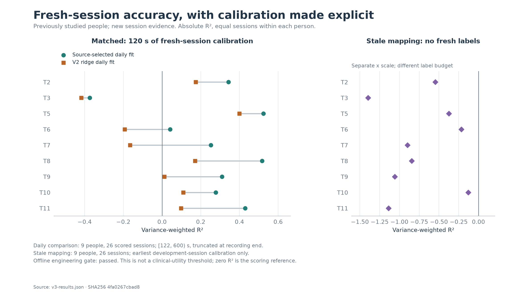
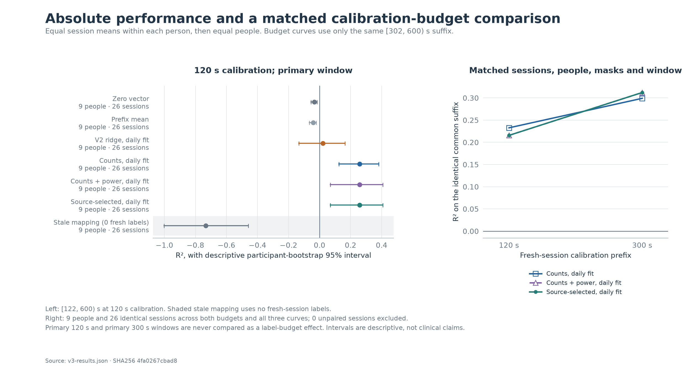

# Recovering useful offline accuracy after failed transfer

The locked daily-calibration procedure reached **0.2578 mean held-out R²**
across nine participants and 26 newly acquired sessions, with a descriptive
participant-bootstrap 95% interval of **[0.0688, 0.4074]**. Eight of nine
participant means and 23 of 26 session scores were positive. Mean angular error
was **51.44°**. Every component of the predeclared offline engineering gate passed.

The matched original ridge recipe, refitted with the same 120-second daily
labels, reached 0.0208 R². The new procedure improved all nine participant means:
paired gain **+0.2370 R²**, interval **[+0.1616, +0.3103]**. These are new-session
results in previously studied people. Daily supervised calibration is essential
to this claim; zero-shot cross-person decoding and a durable frozen mapping are
not established.

## What failed, and what changed

The [V2 failure diagnosis](DIAGNOSIS.md) found that fitting the calibration
prefix was possible, but the learned core's centered prediction–target
correlation fell from 0.7525 in calibration to 0.0584 on later sessions.
Channel-mean displacement grew from 0.073 to 0.719 calibration-standard-deviation
units between the within-session and across-session comparisons. Source
validation was already worse than the zero predictor in 25 of 27 fits at the
earliest checkpoint. Longer training reduced training loss while worsening
validation loss. The random frozen core also outperformed the learned core.

Unbounded outputs amplified the error: 44.04% of learned-core future predictions
lay outside the unit disk. Fixed projection improved its future R² from −1.5907
to −0.6213, still worse than zero. Even an inadmissible oracle error-mean
correction left negative accuracy. Shrinkage alone could not restore a lost
neural–target relationship. The raw-data audit reconstructed targets, masks,
pairing and channel ordering without finding a corresponding implementation bug.
These observations implicate feature shift, weak source generalization,
overfitting and sparse recordings; they do not identify a unique biological cause.

V3 therefore makes five explicit changes:

1. Use square-root threshold counts and optionally log-transformed spike-band
   power, whose dense measurements can retain information where threshold events
   are sparse.
2. Use causal exponential smoothing with state reset at acquisition boundaries.
   No whole-block or whole-session statistics enter inference.
3. Fit prefix-only normalization and a closed-form ridge readout with an explicit
   mean-loss regularization convention and a free intercept.
4. Project outputs onto the unit disk, matching the geometry of the direction
   target, and clip normalized inputs at the fixed training-independent bound.
5. State and evaluate a daily calibration requirement, while preserving a
   separately reported frozen-mapping stress condition.

The final 120-second source selections all chose counts plus power, a 200 ms
filter time constant, no slow-baseline subtraction, and ridge lambda 1. The
procedure updates filter state on every observation, including unscored bins.
Its streaming state and work scale linearly with channel count. This is transfer
of a decoding recipe with participant-specific daily coefficients, rather than
a learned shared neural representation.

## Information boundaries and cohort

The [plan](plan.json) was committed at `9ab460f` before new-session acquisition.
The model, importer and study runner were committed at `1161bd5`. All 3,528
development candidate scores and 54 participant-excluded selections were audited
and published at `c3c205b` before opening fresh assessment labels. The finite
grid contained 36 settings at each budget. Each person's selection excluded that
person's development scores; earlier diagnosis had nevertheless exposed the
whole known cohort and influenced the common study design.

Acquisition selected regular archive session members 7–9, disjoint from V2's
first six. T3 had only eight members, leaving 26 sessions rather than 27; there
was no replacement. Every retained session supplied the first 600 observed
seconds, totaling 780,000 20 ms bins. Selection did not depend on outcomes,
duration or signal quality. All fresh electrode-layout metadata matched the
corresponding old participant layout. See [cohort provenance](DATA.md) and its
[aggregate receipt](../results/v3-cohort.json).

At the primary budget, fitting uses the first 120 observed seconds, with a common
62-bin training exclusion at each acquisition boundary. The primary evaluation
uses `[122,600)` seconds with the unchanged valid-go mask. Effective labeled
training rows range from 1,298 to 5,928; 120 seconds is an observed-time budget,
not 120 seconds of selected movement labels. Features and scorer targets occupy
separate artifacts. Models are exported and reloaded before predictions are
saved and scored. No settings were changed after assessment.

The target remains the contemporaneous unit cursor-to-target direction proxy.
It is not independent intention ground truth, limb velocity, a closed-loop
success rate, or the provider's trial-averaged decoding-SNR endpoint. Archive
order is not temporal order: 25 assessment sessions follow their old calibration
day, while one T6 session precedes it. Between-block wall-clock gaps are unknown.

## Primary results: matched daily calibration

Means first weight sessions equally within each person, then people equally.
Intervals resample nine people with the fixed 10,000-draw seed. They describe a
small convenience cohort with dependent source folds, not population certainty.

| Procedure, 120 s daily calibration | Mean R² | 95% interval | Positive people | Mean angular error |
| --- | ---: | ---: | ---: | ---: |
| Zero vector | −0.0342 | [−0.0559, −0.0167] | 0/9 | 90.00° |
| Calibration-prefix mean | −0.0408 | [−0.0657, −0.0208] | 0/9 | 84.56° |
| Original V2 ridge recipe, daily refit | 0.0208 | [−0.1331, 0.1641] | 6/9 | 59.49° |
| Source-selected count-only recipe | 0.2588 | [0.1253, 0.3814] | 7/9 | 53.77° |
| Source-selected counts + power, locked primary | **0.2578** | **[0.0688, 0.4074]** | **8/9** | **51.44°** |

The overall-selected and counts-plus-power arms are identical here; they are
not independent replications. Count-only and combined arms each have their own
source-selected settings. The combined procedure did **not** improve cohort-average R²
over the selected count-only procedure. It improved angular error and the number
of positive participant means, while worsening T3. The locked primary is retained
despite this result; these arms do not isolate power with every other setting fixed.

| Participant | Sessions | Primary R² | Original daily ridge R² | Primary angular error |
| --- | ---: | ---: | ---: | ---: |
| T2 | 3 | 0.3428 | 0.1734 | 47.00° |
| T3 | 2 | **−0.3734** | −0.4179 | 84.84° |
| T5 | 3 | 0.5235 | 0.4000 | 35.87° |
| T6 | 3 | 0.0421 | −0.1927 | 66.77° |
| T7 | 3 | 0.2521 | −0.1656 | 53.81° |
| T8 | 3 | 0.5171 | 0.1702 | 34.81° |
| T9 | 3 | 0.3096 | 0.0118 | 47.69° |
| T10 | 3 | 0.2774 | 0.1092 | 50.33° |
| T11 | 3 | 0.4289 | 0.0986 | 41.81° |

The primary gain was +0.2920 R² over zero and +0.2986 over the prefix mean.
Its 0.2578 mean exceeded the locked 0.10 threshold, its interval stayed above
zero, eight participant means were positive against a seven-person requirement,
and angular error was below 80°. Passing this offline engineering gate does not
establish clinical usefulness. T3 fails absolutely and T6 remains weak; reporting
only the cohort mean would conceal that limitation.

## More calibration and frozen-mapping stress

The 300-second procedure must be compared on the identical `[302,600)` suffix,
not against the primary procedure's longer, earlier scoring window.

| Procedure on common suffix | 120 s calibration R² | 300 s calibration R² |
| --- | ---: | ---: |
| Original daily ridge | −0.0390 | 0.1581 |
| Selected count-only | 0.2326 | 0.2991 |
| Locked overall-selected | 0.2156 | 0.3122 |

All 26 sessions and nine people contribute to these matched daily comparisons.
The selected 300-second procedure reaches 48.58° mean angular error. Settings
were selected separately at each budget, so this measures two complete
calibration procedures rather than a pure extra-label effect with fixed settings.

When the selected V3 recipe is instead fitted on each person's earliest original
120-second prefix and frozen, its new-session mean is **−0.7340 R²**, with no
positive participant means and 85.12° angular error. This arm receives **zero
fresh-session labels**; its contrast with daily fitting changes the information
budget. It confirms that the result should not be described as a robust
calibration-free mapping. At 300 seconds this stress arm is unavailable for
three T6 sessions because the old calibration recording is too short; those
cases remain explicit. No daily-calibrated case is missing.

## Audits, runtime and reproducibility

The full independent quality audit passed for **361 models, 722 scored traces,
three unavailable model cases and all 3,528 development candidate scores**.
Independent NumPy recurrences reproduced every full prediction trace from the
257 nonconstant models, with maximum absolute error **1.41 × 10⁻¹⁴**. The largest
relative ridge normal-equation residual was **3.01 × 10⁻¹³**; a separate check
verified the free intercept. This checked the
saved coefficients against their actual permitted training rows, in addition
to independently recomputing scores and the operational gate.

The [aggregate assessment](../results/v3-results.json) contains that receipt,
all participant/session scores and the exact run identities. The model/study/data
sources remain those frozen before selection. The exact executed auditor is also
retained separately. See the
[reproduction guide](README.md) for fitting, independent replay/scoring,
aggregate export, and the three-fast/two-paced timing protocol.

The audit scope includes independent source-score and selection reconstruction,
complete case inventory, raw/prepared identity checks, prefix normalization,
ridge optimality equations, recording resets, full assessment prediction
replay, scoring masks, metrics, summaries and the gate. Source-grid fits are not
independently retrained. Hashes establish byte identity; causal information
boundaries also rely on reviewed code and mutation tests.

The runtime representative was fixed by identity order, without choosing on
accuracy: **T2_day_137_decoding**, selected daily 120-second export, model SHA256
`459337ca589951e5d65aa0262a28b8933bd354814841699b9437be08eb532c26`.
The 96-electrode combined input produces 192 transformed features and 386
readout coefficients. Numeric model arrays occupy 6,160 bytes and persistent
filter state 3,072 bytes, excluding Python objects, scratch space and loaded
replay data. The process high-water RSS reached 337,739,776 bytes because this
offline harness also loads inputs and parity workspaces; it is not the numeric
state footprint.

| Measured mode on macOS ARM64 | Processing p99 | Release-to-completion p99 | 20 ms misses |
| --- | ---: | ---: | ---: |
| Fast repeat 1, 30,000 steps | 0.016709 ms | 0.016750 ms | 0 |
| Fast repeat 2, 30,000 steps | 0.015750 ms | 0.015792 ms | 0 |
| Fast repeat 3, 30,000 steps | 0.014375 ms | 0.014458 ms | 0 |
| Paced block 1, 3,000 steps / 60 s | 0.661767 ms | 5.131575 ms | 0 |
| Paced block 2, 3,000 steps / 60 s | 0.622156 ms | 5.101263 ms | 0 |

The two paced blocks use fixed 20 ms nominal releases and ordinary sleeping.
Scheduling p99 was 4.912–4.917 ms. Maximum processing times were 2.921 and
2.063 ms, so the 2 ms processing **p99** target passes without implying that
every step is below 2 ms. Model loading took 1.268 ms and is excluded from
per-step timing; constructor initialization is also reported separately.
All 30,000 batch/stream predictions agreed within 3.17 × 10⁻¹⁵. A separate
timestamp auditor reconstructed all five blocks from integer timestamps;
it does not independently execute decoder predictions. See the complete
[runtime receipt](../results/v3-runtime.json).

The selected filter has a 200 ms time constant, 190.17 ms steady-state mean
sample age and a 30-bin (600 ms) 95% step response. These describe smoothing,
not CPU cost or a fixed end-to-end delay. Timing applies to this one export
on this host; no hard real-time or whole-cohort timing guarantee follows.

Raw recordings, prepared samples, calibration coefficients, models, predictions,
transport URLs and timing arrays remain in ignored local caches. Public evidence
contains aggregate scores, metadata, exact identities and audit receipts. The
original V1 and V2 results remain unchanged, including their negative results.

## Remaining evidence needed

An untouched participant cohort is still needed to confirm that design choices
generalize beyond these known people. T3 needs a prospectively tested remedy;
the present assessment cannot be reused for tuning and then called held out.
Useful control also requires prospective closed-loop evaluation with a suitable
movement endpoint, and a separate strategy for recalibration or drift adaptation
that does not assume fresh movement labels are always available.

Runtime begins at supplied neural features. Upstream feature causality,
acquisition and transport latency, hard real-time guarantees, implant power and
clinical benefit remain unverified. Causal smoothing has no future lookahead,
but its response time must be reported separately from CPU processing latency.
