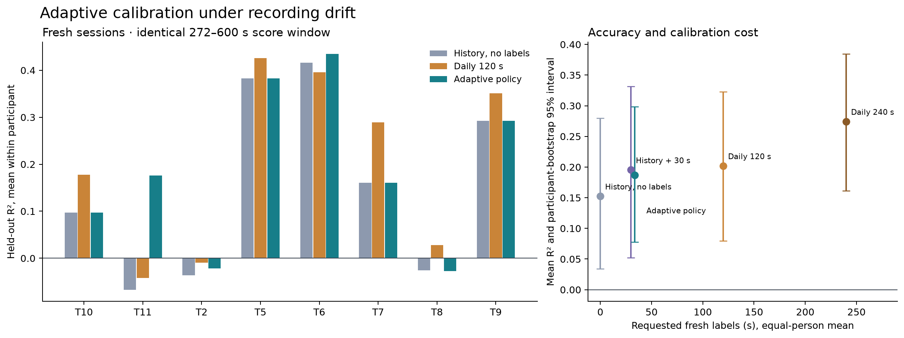
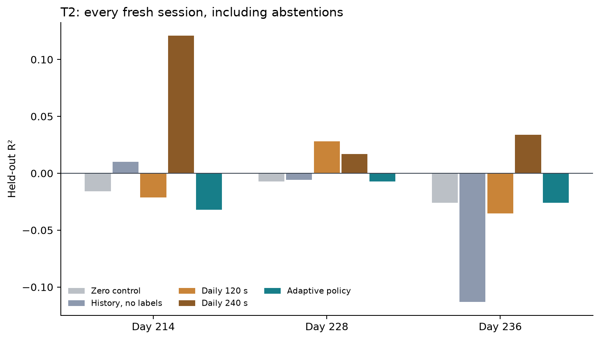

# V5: adaptive calibration and negative transfer

The frozen adaptive policy achieved useful cohort-level decoding with **33.75
seconds of requested fresh labels per session**, averaged equally across eight
known participants. Mean held-out R² was **0.187 [0.078, 0.299]**. It reused history
without fresh labels on 17 of 24 selected sessions. These results support a
promising accuracy–calibration tradeoff, but **neither T2 recovery nor preservation
of 120-second daily-calibration accuracy passed its predeclared gate**.

All results below come from the one-shot assessment and its passed separate-code
audit. The policy was not retuned after these outcomes. See the
[complete aggregates](../results/v5-study.json), [protocol](PROTOCOL.md),
[data receipt](DATA.md), and [reproduction guide](README.md).

## Why the policy changed

The [exploratory diagnosis](DIAGNOSIS.md) used only previously exposed T2 data.
Latest-session-only history and stronger low-label adaptation worsened results.
Short calibration prefixes could learn direction bias; removing spike-band power
reduced some harm without recovering useful decoding. Coefficient instability
was consistent with unreliable transfer, but does not establish a physical
remapping mechanism. All 1,728 pilot fits and 288 prefix selections were retained.

V5 therefore makes history reuse, further label collection, scratch fitting and
abstention explicit decisions. After a 30-second unlabeled warmup, the controller:

1. Reuses a historical model only if prior out-of-session probes meet the frozen
   error thresholds. It uses up to three strictly earlier, layout-matched sessions.
2. Otherwise requests cumulative 30, 60, 120 or 240 seconds of subsequent labels.
   Six small candidates compare count-only and count-plus-power features with
   historical, scratch and strongly regularized zero-intercept heads.
3. Requires chronological prefix validation, a two-second purge, directional
   coverage, and improvement over both zero and training-mean controls across
   at least two thirds of eligible two-second groups. It refits an accepted
   candidate on the available labeled prefix.
4. Returns zero output if no candidate passes at the cap. Abstentions remain in
   accuracy and cost accounting.

The historical reuse gate cannot detect an arbitrary new mapping change without
current labels. The prefix tests are empirical safeguards, not calibrated risk
bounds or an anytime-valid sequential test. The experiment implements startup
calibration decisions; it does not implement ongoing drift-triggered recalibration
after deployment.

## Fresh cohort and information boundaries

Acquisition ranks 13–15 supplied 24 new sessions from T2, T5, T6, T7, T8, T9, T10
and T11. **22 sessions were scorable** on the identical 272–600 second window.
T6 days 1048 and 1057 had zero eligible score rows; both remain in the 24-session
cost ledger. T6 accuracy therefore represents one session. No failed or short
case was replaced. Seventeen sessions used no new labels; all required the
30-second unlabeled warmup and previously labeled history.

The acquisition order was fixed before new data access. Archive rank is not
acquisition chronology: T8 day38 has no strictly earlier development history.
This is an archive-rank holdout across known people, not a forward-day evaluation
for every case or an untouched-participant test. Policy thresholds were selected
with each target participant wholly excluded from selection, but deployment uses
that person's allowed earlier recordings. The fixed development pool contained
104 previously exposed prefixes; no fresh assessment session entered another
case's history.

Seven T3 recordings supplied new continuation blocks, kept separate from the
eight-person cohort. Day62 had no remaining complete block and remains an
explicit unavailable disposition. Day36 supplied only one remaining block.

Labels represent offline cursor-to-target direction. They are neither measured
limb velocity nor evidence of closed-loop cursor control. Source and target
normalization, block resets, burn-in, acquisition geometry and score masks were
reconstructed independently. Models never received final scoring labels.

## Matched results

R² aggregates squared error across the two coordinates. Sessions receive equal
weight within each person; people receive equal weight. Intervals use 10,000
participant bootstrap draws, seed 20261024. These eight known people are a small,
selected cohort; the intervals do not establish population-wide performance.

| Method | Requested labels, mean | Mean R² [95% interval] | Positive people | Angular error |
| --- | ---: | --- | ---: | ---: |
| Zero output | 0 s | −0.071 [−0.121, −0.028] | 0/8 | 90.00° |
| Fixed historical prior | 0 s | 0.153 [0.034, 0.280] | 5/8 | 59.05° |
| Fixed prior + adaptation | 30 s | 0.195 [0.052, 0.331] | 6/8 | 54.69° |
| Daily scratch fit | 120 s | 0.202 [0.080, 0.323] | 6/8 | 53.85° |
| Daily scratch fit | 240 s | 0.274 [0.161, 0.385] | 8/8 | 50.13° |
| **Adaptive policy** | **33.75 s** | **0.187 [0.078, 0.299]** | **6/8** | **58.08°** |

The adaptive policy requested **71.9% fewer labels than daily120**. Its paired
R² difference from daily120 was **−0.015 [−0.073, 0.062]**: the lower endpoint
crosses the declared −0.05 margin, so noninferiority failed. The comparison with
fixed history0 was **+0.034 [0.001, 0.096]**. Fixed history30 achieved slightly
higher accuracy with slightly fewer labels; adaptive minus history30 was
**−0.009 [−0.079, 0.086]**. Thus the policy does not dominate all simple baselines.
Daily240 was more accurate, with adaptive minus daily240
**−0.087 [−0.154, −0.005]**.

Requested and available adaptive labels both average 33.75 seconds. Daily240
requests 240 seconds but averages 239.81 available seconds because T6 day1048 ends
before the full request can be fulfilled; it remains in cost accounting.

Adaptive acceptance covered **20/22 scored sessions**. Two accepted sessions had
negative R²: T2 day214 and T8 day38. Two T2 sessions abstained. Reporting only
accepted accuracy would hide the operational cost of refusal. Fixed daily arms
also receive stronger normalization using their entire available unlabeled
prefix, whereas adaptive candidates freeze normalization at 30 seconds. This is
a comparison of complete procedures, not an isolated test of stopping thresholds.

| Predeclared gate | Outcome | Evidence |
| --- | --- | --- |
| Useful adaptive accuracy | PASS | R² 0.187, lower interval >0, 6/8 positive, gain over zero 0.258, angular error 58.08° |
| Reduced calibration with daily120 noninferiority | FAIL | Cost passes, paired lower R² difference −0.073 is below −0.05 |
| T2 recovered | FAIL | Mean R² −0.022; no positive accepted sessions |

## T2: less blind reuse, no reliable recovery

| T2 day | History0 R² | Daily120 R² | Daily240 R² | Adaptive decision | Adaptive R² |
| --- | ---: | ---: | ---: | --- | ---: |
| 214 | 0.010 | −0.021 | 0.121 | Accept scratch count+power, 120 s | −0.032 |
| 228 | −0.006 | 0.028 | 0.017 | Abstain after 240 s | −0.007 |
| 236 | −0.113 | −0.035 | 0.034 | Abstain after 240 s | −0.026 |
| Mean | −0.036 | −0.009 | **0.057** | 200 s requested | **−0.022** |

The policy rejected zero-label history on all three days. On day214, the accepted
candidate beat the zero and prefix-mean controls in 16/24 validation groups,
with coordinate MSE 0.435 versus 0.500 and 0.489. Its later held-out coordinate
MSE was 0.508, worse than zero. Passing one chronological prefix partition did
not predict later reliability. On days228 and236, the policy refused to deploy,
although fixed daily240 scored modestly positive. The adaptive gain over history0
was only **0.015 [−0.042, 0.087]**, with no reliable T2 repair established.

The predeclared daily240 comparator produced positive R² on all three T2 days
and mean 0.057. This is evidence that additional calibration can help this small
fresh cohort. It is not a successful adaptive recovery: the policy stopped too
early on day214 and declined the other two. Its frozen 30-second normalizer also
differs from daily240, so label quantity alone does not explain that contrast.

These outcomes motivate testing temporally separated calibration probes and
better validation-to-future risk estimates in a new study. They do not justify
adjusting thresholds on this consumed holdout and calling the result fresh.

## T3 negative control

All seven fresh T3 continuations reached 240 seconds and abstained. Adaptive R²
therefore equals the zero control: **−0.084 [−0.173, −0.031]**. Fixed history0
scored −0.230, history30 −0.360, daily120 −0.667 and daily240 −0.453.
The adaptive gain over daily120 was 0.582 [0.308, 0.929], but it comes entirely
from refusing harmful predictions. **T3 remains unrecovered**, and this policy
did not save T3 calibration time. These session-bootstrap intervals describe
seven continuations from one person and are never pooled with participant CIs.

## Verification and provenance

The acquisition plan was committed as `db5ca7b`, the evaluation plan as `4b39a60`,
and the frozen executed implementation as `c41f793`. Source choices and their
passed audit were published in `bfedd1e` before fresh assessment. The ten
execution-source hashes remained unchanged through assessment; the public
aggregate includes them and the exact input/artifact bindings.

The source audit reconstructed 1,147 fits, 208 historical probes, 2,291 model
records and all nine participant-exclusion choices. The fresh assessment audit
checked **186 complete traces, 365 fits, 551 model records and 31 policy
decisions**, plus 12 unavailable score rows (two sessions × six methods).
Maximum replay error was **1.47 × 10⁻¹⁴** and maximum relative normal-equation
residual **3.08 × 10⁻¹⁴**. It independently reproduced every metric, uncertainty
interval and gate outcome.

Two auditor corrections are retained transparently: source attempt1 used a
different float precision at an octant boundary; assessment attempt1 mistook
eight valid acquisition-completeness records for missing-case records. Narrow
reference/schema fixes and regression tests preceded passing second attempts.
No scientific producer, prepared data, selection or assessment result changed.
This is separate-code verification by an agent that also authored the policy,
not external-laboratory replication.

| Bound artifact | SHA256 |
| --- | --- |
| Source selection | `c9bc13df6eda97efd1e26cbd050993101aca2589d5da5d4d029e522ffcd7a044` |
| Source audit | `30419cfbf548fb0ccfd8b625d2298d63db6afd2886509c1adc7629ff3b5cb19c` |
| Fresh assessment and manifest | `190a47a2b5e388ced713f6f7b1cd0b15b644f9342f993c142deb338c20313f7c` |
| Assessment audit | `04dc238302daa5feee9ef1f3269af5168c3f6bd7d2a5b2df327fae1025aacca2` |

GitHub receives source, aggregate metrics, decision summaries, plots and hashes.
Raw features, targets, fitted coefficients and sample-level replay traces stay in
ignored local caches. [Validation evidence](../results/v5-validation.json)
records software checks and audit attempts. The
[runtime receipt](../results/v5-runtime.json) binds streaming measurements to
the predetermined T2 day214 export, including its negative accuracy result.

## Runtime and calibration compute

The predetermined representative was the accepted T2 day214 model, even though
its held-out R² was negative. Three fast replays measured processing p99
**0.0192–0.0202 ms**. Two 60-second runs paced at 20 ms measured processing p99
**0.970–1.006 ms**, queue delay p99 **9.563–9.576 ms**, and release-to-completion
p99 **9.788–9.993 ms**. There were **zero missed deadlines in 6,000 paced updates**.
Independent timestamp and prediction audits passed. The measured-replay maximum
prediction error was 9.99×10⁻¹⁶; independent reconstruction against the assessed
trace differed by 1.03×10⁻¹⁴.

Numeric model arrays occupy 6,160 bytes and persistent numeric filter state 3,072
bytes. Peak process RSS was 457,736,192 bytes, including input arrays and parity
workspace, and must not be represented as decoder-only memory. Paced process CPU
utilization was 1.30–1.93%. Environment variables and threadpoolctl requested one
BLAS thread; introspection returned no detected native pools, so effective native
pool size was not independently confirmed. This host timing is not a hard
real-time guarantee. The 200 ms filter has about 190 ms mean sample age, separate
from CPU processing time.

Across 45 calibration stages, validation construction averaged 10.23 ms and
reached 17.81 ms. This instrumentation includes prefix-label access and the six
half-prefix candidate fits/exports; it excludes full final refitting and historical
model construction. It is **not total calibration latency**, nor evidence that
calibration can run concurrently without disrupting streaming. Label acquisition
still takes the requested 30–240 seconds after the 30-second unlabeled warmup.

## Boundaries of the result

No closed-loop experiment, prospective clinical deployment or unseen-participant
generalization was performed. This benchmark begins at precomputed neural
features; upstream feature extraction and acquisition latency are unverified.
The policy selects among small linear decoders and uses task-provided direction
labels during calibration; autonomous label generation is not implemented.
The new-session cohort and score window differ from V4, so comparing their
headline means would not measure a matched improvement. History reuse and label
collection are promising, but reliable individual-level stopping remains an open
engineering problem demonstrated by the retained T2 and T8 failures.
