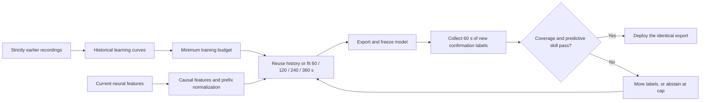

# V6 protocol: confirm the deployed model and learn when to spend more labels

V6 tests whether a controller can reduce false acceptance while retaining useful
decoding, particularly for T2. It compares procedures on the same fresh sessions
and scoring windows. The [machine-readable plan](plan.json) fixes every threshold,
candidate, input, comparison and gate before fresh outcome preparation.

## What the exposed failures changed

V5 evaluated a half-prefix model and then deployed a full-prefix refit. V6 instead
exports the full fit before a subsequent confirmation interval and deploys those
exact bytes. The [exposed-data diagnosis](DIAGNOSIS.md) shows why this alone is
insufficient: a model can pass immediate confirmation and fail later. Longer
fixed fits helped several T2 cases, while a twelve-way short-prefix selector
discarded useful fits. V6 therefore fixes the combined-feature ridge-1 candidate
and tests a small confirmation-policy grid, rather than selecting a new model
from each short validation window.

These design choices were informed by all previously exposed data, including
T2. Participant exclusion during threshold selection does not erase that design
history. Fresh session assessment supplies the independent outcome evidence.

## Information flow

The first 30 recorded seconds supply unlabeled normalization. A stage with
training budget `b` fits labels in `[30,30+b)`, freezes its normalizer and weights,
and confirms on `[32+b,90+b)`. The initial two seconds of the confirmation request
are a purge, still counted in cost. Prior reuse has `b=0`, so it consumes **60
seconds of confirmation labels**, not zero labels. Maximum requested labels are
420 seconds and the maximum decision time is 450 recorded seconds. Time here
means recorded observations after binning, not measured wall-clock user effort.

Rejected confirmation labels may become training data at a later stage. Each
later confirmation remains new to that fit. No model selection, coefficient
update or normalizer update follows a successful confirmation. The deployment
and final scoring artifacts must have the exact confirmed model hash.

Each pooled 58-second window and its two 29-second halves needs at least 100
valid rows and four of eight direction sectors with at least ten rows each.
Both halves must improve coordinate MSE over zero and a fixed training-label-mean
predictor. The historical model uses zero as that null. Pooled R² uses the
confirmation window's own target mean and variance, testing prediction beyond
constant direction bias. Four policies cross MSE gain margins `0` and `0.025`
with pooled R² thresholds `0` and `0.05`. Zero thresholds require strict
improvement; positive thresholds use inclusive comparisons. These empirical
tests are not calibrated sequential risk guarantees.

## Historical budget routing

Histories are the last three strictly earlier, same-person, same-layout recordings
from the fixed development pool, selected before availability checks. Their
fixed 120/240/360-second models are scored on their own later `[452,600)` windows.
At least two paired eligible histories are required to change the budget floor.

If their mean 120-second R² is at most 0.05, the floor becomes 240 when the
240-second mean is positive, its paired improvement over 120 is at least 0.03,
and at least two thirds of paired gains are positive. A corresponding 240-to-360
improvement sets the floor to 360 independently of whether the 240 rule fired.
Otherwise the floor is zero. This routing applies before historical reuse too.
Relative improvement that remains consistently useless does not justify a floor.

Historical fits use equal-session sufficient statistics, ridge regularization,
block resets and burned training rows. A historical prior's feature family is
chosen from strictly earlier out-of-session probes, never current confirmation
labels. Every identity, exclusion and loss entering routing is retained.

## Development and fresh evaluation

Development contains 128 already-exposed prefixes of at most 600 seconds: 104
from V5 development plus its 24 newly tested sessions. T3 contributes only its
eight original prefixes; its continuation labels are excluded. All prepared
parent bytes are reused exactly. Source threshold selection excludes the entire
target person and weights sessions equally within people, then people equally.
Feasible configurations need coverage of at least 60% and R² within 0.05 of
daily240. Ranking then minimizes harmful and nonpositive acceptance burdens,
maximizes R² and minimizes label cost. A fixed utility fallback is declared in
the plan if no configuration qualifies.

Fresh acquisition fixes archive ranks 16–18 for eight known non-T3 participants,
24 requested sessions, without duration or outcome substitutions. Archive order
is not chronological day order. The historical pool never incorporates another
fresh assessment case. This is new-session evaluation across known people, not
an untouched-person test. No fresh T3 continuation is included in V6.

All seven methods score the identical `[452,600)` suffix with at least 50 valid
rows: zero, fixed history0, daily120, daily240, daily360, matched-history V5 and
the confirmed policy. The V5 comparator retains its original policy thresholds,
model code, calibration schedule and reliability-window definition, while using
the same 128-session history pool as V6. Short or no-go sessions remain in label
cost accounting even when accuracy is unavailable. No cutoff changes follow
inspection of fresh durations.

The target remains the offline unit cursor-to-target direction proxy. Final
labels enter the scorer only after the policy stops. The label broker returns
only the requested prefix to the model and controller; it internally loads a
compressed target file, so this is an information-flow boundary rather than
filesystem isolation. Counterfactual controls have separate label access.
Features are precomputed; upstream extraction causality,
transport latency, closed-loop utility and clinical benefit are unverified.

## Metrics and falsifiable claims

Report all-case R², angular error, requested and available labels, training budget,
decision time, acceptance coverage and every abstention. Distinguish accepted
R² at or below zero from accepted predictions worse than zero-output MSE. Report
raw counts, conditional fractions and equal-person burdens. Abstain-all cannot
pass the useful-accuracy and coverage gates.

Participant bootstrap intervals use 10,000 draws and seed 20261025. T2's
session-bootstrap intervals are descriptive small-sample quantities. Two-second
confirmation groups are diagnostic aggregates, not independent trials.

A prespecified descriptive opportunity analysis asks when fixed daily240 or
daily360 exceeds both daily120 and zero by at least 0.05 R². The policy captures
an opportunity only when it accepts a model trained for at least 240 seconds and
gains at least 0.025 R² over daily120. This comparison is computed by the scorer;
the policy never sees its outcome. Empty opportunity sets are unavailable, not
automatic successes.

The plan separately gates useful cohort accuracy, fewer observed false
acceptances with useful coverage, T2 recovery without harmful acceptance, and
capture of later-label benefit. A failed gate remains failed. No threshold,
candidate or policy is revised after fresh outcomes are opened.

## Evidence and runtime

Source choices require a passed separate-code audit and publication before fresh
assessment. The assessment audit independently reconstructs fitting, causal
features, label boundaries, exact confirmation artifacts, decisions, common masks,
costs, bootstrap intervals and gates. Hashes establish identity, not predictive
reliability. The controller and its reference verifier are authored within the
same project; this is not external replication.

Runtime measures the exact confirmed T2 rank16 export even if it abstains or has
negative accuracy. Three fast replays and two 60-second runs paced at 20 ms use
the existing numeric streaming core after other heavy compute stops. Processing,
scheduling, filter response and memory are reported separately. No local Rust
compilation is used. Public outputs contain aggregates and hashes; raw samples,
targets, fitted weights and replay traces remain in ignored local storage.
