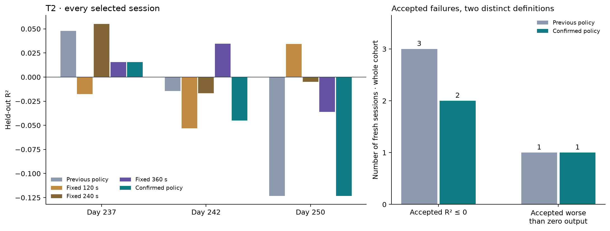

# V6: exact-model confirmation and adaptive label budgets

**The new policy failed all four prespecified success gates.** It removed one
accepted nonpositive-R² case but did not reduce acceptances worse than zero
output. Accuracy fell and requested labels increased. T2 remains unrecovered.
The implementation and complete negative result are retained as an experimental
candidate, not promoted as an improved replacement.

## Question and design

Can startup calibration reject unreliable models while recognizing when longer
training is useful, particularly for T2? The prior controller could approve a
short validation fit and deploy different refitted weights. V6 freezes and
exports the full fitted model before confirmation, requires useful prediction
in both temporal halves of that confirmation, and deploys those identical bytes.
Historical learning curves can raise the minimum training budget before any
current-session acceptance decision.

The exposed T2 diagnosis suggested this mechanism, but also retained a strong
counterexample: day 187 passed immediate confirmation and failed later. No
finite confirmation interval guarantees future reliability under drift. The
fresh test therefore evaluates the entire procedure, including failed
acceptances, label costs and abstentions.

The acquisition rule was published in commit `92cf69a`; the complete scientific
plan and execution sources in `f7c81cb`, before fresh outcome preparation.
The [protocol](PROTOCOL.md) and [machine-readable plan](plan.json) fix the target,
models, policy grid, historical routing, selection rule, comparisons and gates.

## Development result and frozen policy

Development used 128 already-exposed prefixes across nine people. A bounded
fifteen-session T2 pilot compared twelve feature/readout/normalization variants
and retained every fit. Short-prefix model selection was unreliable; the
production fit fixes combined spike counts and spike-band power, causal 200 ms
smoothing, ridge regularization and normalization through the training stop.
See the [diagnosis](DIAGNOSIS.md) for positive and negative exposed results.

All nine whole-person-excluded selections chose `c3`: pooled confirmation R² at
least 0.05 and at least 0.025 coordinate-MSE improvement over both zero and the
fixed training-label mean in each half. This is the strictest of four declared
policies. **None met the source feasibility criterion** of accuracy within 0.05
R² of fixed daily240 with at least 60% coverage. Every selection therefore used
the declared utility fallback. For T2's exclusion, the selected source mean was
0.177 versus daily240's 0.249, at 87.5% equal-person coverage and 133.5 requested
label seconds. These are exposed development quantities, not held-out evidence.

Applied to exposed T2 days 214, 228 and 236, `c3` accepted training budgets of
360, 240 and 360 seconds, with late-window R² of 0.101, 0.006 and 0.083. It
abstained on days 187, 194 and 209, but still falsely accepted days 103 and 110
with negative late R². The development result therefore supports testing the
mechanism, not claiming false acceptance has been eliminated.

T2 informed the design itself. Excluding T2 from threshold ranking does not make
this an untouched-participant model-development experiment. Independent evidence
comes from the new sessions selected before their outcomes were prepared.

## Fresh assessment

The audited source choices were published in commit `745df22` before fresh
assessment. The acquisition retained all 24 fixed sessions, with no failures,
missing ranks or substitutions. Twenty-two had at least 50 valid rows in the
common `[452,600)` score window. T5 day 140 and T6 day 1088 ended before that
window; both remain in requested and available label accounting.

| Procedure | Mean requested labels | Mean R² [participant-bootstrap 95% interval] | Accepted / scored | Nonpositive / harmful accepted |
| --- | ---: | --- | ---: | ---: |
| Zero output | 0 s | −0.059 [−0.113, −0.019] | 0/22 | 0/0 |
| Fixed historical prior | 0 s | 0.054 [−0.228, 0.246] | 22/22 | 6/4 |
| Fixed daily120 | 120 s | 0.203 [0.013, 0.355] | 22/22 | 4/3 |
| Fixed daily240 | 240 s | 0.221 [0.023, 0.379] | 22/22 | 4/2 |
| Fixed daily360 | 360 s | 0.261 [0.100, 0.397] | 22/22 | 3/2 |
| Matched-history V5 policy | 31.25 s | 0.104 [−0.153, 0.282] | 21/22 | 3/1 |
| **Confirmed V6 policy** | **175 s** | **0.053 [−0.234, 0.242]** | **18/22** | **2/1** |

The confirmed policy lost **0.051 R² [−0.105, −0.010]** relative to matched V5
and used **5.6 times as many requested labels**. Its acceptance coverage was
81.8%, versus 95.5% for V5. Conditional on acceptance, nonpositive outcomes were
2/18 versus 3/21; harmful outcomes were 1/18 versus 1/21. The equal-participant
nonpositive burden difference was −0.042 [−0.125, 0], while harmful burden did
not change. A smaller count is not evidence that the policy became reliably
safer or more accurate.

Six of eight participant means were positive under the confirmed policy.
Fixed daily360 had seven positive participant means and the highest cohort
mean among the prespecified controls, but it also retained two harmful sessions.
These comparisons do not establish that any tested method is ready for control.

### T2: all three requested sessions

| Post-implant day | Daily120 R² | Daily240 R² | Daily360 R² | V5 R² | V6 R² | V6 decision |
| --- | ---: | ---: | ---: | ---: | ---: | --- |
| 237 | −0.018 | 0.055 | 0.016 | 0.048 | 0.016 | Accept 360-second fit |
| 242 | −0.053 | −0.017 | 0.035 | −0.014 | −0.045 | Abstain |
| 250 | 0.034 | −0.005 | −0.036 | −0.123 | −0.123 | Abstain |

All three inherited a 360-second training floor from the same strictly earlier
days 214, 228 and 236, and requested 420 label seconds including confirmation.
T2's mean V6 R² was **−0.0508**, with one positive accepted session and no
acceptance worse than zero. Its descriptive three-session interval was
[−0.1231, 0.0157]; its mean difference from V5 was −0.0209.

Day 242 explains why the nonpositive-acceptance count is insufficient: V5's
negative-R² prediction nevertheless beat zero output. V6 removed that
acceptance but replaced it with a worse zero prediction. The 360-second model
also achieved positive late accuracy on that day despite poor immediate
confirmation, so the check rejected a model that later helped. On day 250,
longer fixed fits were worse than daily120. Historical budget evidence therefore
did not identify the best current-session training extent.

### Why confirmation and budget routing still failed

T8 day 42 passed the prior-reuse check: pooled confirmation R² was **0.236**, with
positive gains over zero in both halves. The identical exported model then had
late R² **−2.838** and MSE worse than zero. The artifact mismatch was removed,
but a short successful window did not predict later usefulness. This single
large error is retained in the cohort mean; dropping T8 would hide the central
failure.

The policy captured **3 of 10** declared later-label opportunities: T2 day 237,
T9 day 237 and T11 day 1268. It missed five by accepting a short fit or history
before collecting more labels, and missed two despite escalation because it
abstained. This scorer-only counterfactual analysis cannot be used as a
prospective policy without new validation. The normalizer also changes with the
training prefix, so these are comparisons of complete calibration recipes, not
an isolated causal effect of label count.

| Prespecified gate | Outcome |
| --- | --- |
| Useful cohort accuracy | **FAIL**: mean below 0.1 and interval crosses zero |
| Fewer false acceptances with useful coverage | **FAIL**: useful-accuracy requirement not met; harmful count unchanged |
| T2 recovery without harmful acceptance | **FAIL**: only one positive accepted case, negative mean and negative gain over V5 |
| Capture later-label benefit | **FAIL**: 3/10, below the required half |

A future experiment should test whether current-session evidence can estimate
additional-label benefit and detect a loss of usefulness after deployment. This
run does not validate such a mechanism. Tightening the same startup thresholds
or claiming that more labels always help would not follow from these results.
No policy, threshold or candidate was revised after these fresh outcomes opened.

## Interpretation boundaries

The target is unit cursor-to-target direction on valid go-state pairs, an
offline intention proxy. R² uses the scoring window's own target variance.
Abstention produces zero output and can have negative R² when targets are biased.
An accepted model with R² at or below zero and an accepted model with MSE worse
than zero output are distinct failure definitions; both are reported.

Accuracy and risk burdens average eligible sessions within participant, then
participants equally. Coverage and conditional failure fractions count pooled
scorable sessions. Label cost retains every selected session, including those
too short or without a valid scoring window. Bootstrap intervals resample people;
three-session T2 intervals are descriptive and provide little population evidence.

The budget counts recorded label seconds after a thirty-second unlabeled warmup.
Historical reuse in V6 still requires sixty seconds of confirmation labels.
Rejected confirmation labels may become training data at a later stage, whose
confirmation window is new. Fixed-budget controls do not pay confirmation cost;
this comparison evaluates complete procedures rather than pretending they have
equal information budgets.

The controller sees only the prefix returned by its label broker. The offline
broker internally opens compressed target files, so this is a model-information
boundary, not operating-system isolation. Fresh assessment sessions never enter
each other's history. All seven methods use the same prespecified late window.

This is startup calibration on new sessions from known people. Ongoing drift
monitoring, untouched-person transfer, closed-loop utility, clinical benefit,
upstream extraction causality and acquisition latency remain unestablished.
No new T3 continuation is evaluated here; prior T3 failures remain in earlier
reports. The separate-code auditor is part of this project, not external
replication or a statistical safety certification.

## Independent verification and runtime

The source audit passed its first execution: 512 policy cases, 256 historical
probes, 1,760 fits, 3,296 model exports, 1,536 full traces and all nine excluded-
participant source choices. Maximum prediction discrepancy was 1.38 × 10⁻¹⁴.

The fresh assessment audit also passed its first execution, independently
checking **168 full traces, 206 fits, 374 model exports and 24 decisions**, plus
all metrics, intervals, opportunities and gates. Fourteen unavailable method
scores correspond exactly to the two short sessions. Maximum prediction
discrepancy was **1.08 × 10⁻¹⁴**. All fifteen scientific execution files remained
unchanged from the committed source run.

Synthetic testing identified an auditor-only assumption about recordings shorter
than thirty seconds. The verifier was corrected to match the producer's already
specified observed-prefix, no-fit zero fallback, and its exact original source
snapshot was retained. No fresh recording was that short; no producer or score
changed. Downloader hardening after successful acquisition similarly preserves
its executed version separately from the subsequently published resume checks.

The predetermined T2 day 237 export was measured despite its low late R²
of 0.0157. Three fast full-trace repeats measured processing p99 of
0.0181–0.0197 ms. Two sixty-second runs paced at 20 ms measured processing p99
0.795–0.904 ms, scheduling queue p99 4.916–4.925 ms and release-to-completion p99
5.188–5.232 ms. There were zero deadline misses in 6,000 paced updates.

Numeric model arrays use 6,160 bytes and persistent numeric filter state
3,072 bytes. Peak process RSS was 443,187,200 bytes, including loaded input and
parity workspaces; this is distinct from model memory. The independent runtime
verifier reproduced assessed predictions within 7.94 × 10⁻¹⁵ and measured
replay within 7.22 × 10⁻¹⁶, and reconstructed timing from raw timestamps.

Timing replays the frozen export independently of when its original calibration
decision occurred; it supplies no new prospective accuracy evidence. The 200 ms
filter's mean sample age is about 190 ms, separate from CPU latency. Single-
thread settings were applied, but native pool introspection returned no entries
on this Accelerate environment. The finite, single-machine measurements do not
establish hard real-time guarantees or acquisition-to-control latency.

The final local suite passed **789 tests with 22 optional skips**. Ruff, formatting
and diff checks passed. No local Rust compilation was performed; installed
native Python libraries were reused. The [validation receipt](../results/v6-validation.json)
binds tested source hashes, audit attempts and aggregate artifacts. GitHub records
hosted checks on the final PR revision and merged main revision.

## Reproduction and evidence

The [reproduction guide](README.md) specifies acquisition, source selection,
one-shot assessment, independent reconstruction, publication and runtime commands.
The [data record](DATA.md) explains the fixed archive ranks and exact parent
artifacts. Raw recordings, targets, coefficients and sample predictions remain
local; public results contain aggregate metrics, decisions and artifact hashes.
