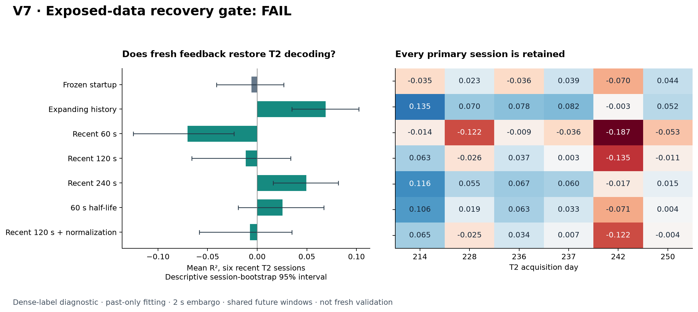

# V7A: T2 recoverability with recent labels

**Accumulating additional labels improved T2 decoding, but none of the five
eligible recency methods passed the prespecified recovery gate.** The expanding
history control raised mean R² from −0.00579 to 0.06892 across the six primary T2
sessions and improved every session. The best eligible method, rolling240,
reached 0.049538, narrowly below the locked 0.05 floor. The gate remains **FAIL**.

This is an exposed-data diagnostic, not a fresh assessment. It asks whether
timely labels can improve future predictions before deciding how to acquire
those labels efficiently. The distinction matters: expanding history used
540 unique label seconds versus 120 for the frozen startup model, and this
diagnostic did not simulate interruptions while collecting those labels.

The numerical evidence is available in
[the complete public aggregates](../results/v7-recovery.json) and
[the independent audit receipt](../results/v7-recovery-audit.json).
The unchanged [original protocol](PROTOCOL.md) and
[machine-readable plan](recovery-plan.json) define the experiment and gate.

## What was tested

The study retained all 152 previously exposed session prefixes from nine
participants. Each prefix contains at most 600 recorded seconds; no new archive
member or unseen recording tail was used. The six T2 sessions with greatest
numeric acquisition day were the primary set: days 214, 228, 236, 237, 242 and
250. All six were scorable. Across the full exposed cohort, 142 sessions had
eligible future scoring windows; all 10 unavailable session scores remained in
the result inventory.

Every decoder used the same combined spike-count and spike-band-power features,
causal 200 ms filter, ridge penalty 1, free intercept and unit-disk output
projection. The main comparisons held normalization fixed to the first 30
seconds. A separate rolling120 ablation recomputed normalization on its own
past training window, allowing normalization changes to be distinguished from
coefficient updates.

The frozen model used labels from seconds 30–150. Updated models were fit at
272, 332, 392, 452, 512 and 572 seconds, using labels ending two seconds before
each boundary. They predicted the following 60 seconds, truncated at the
recording end or 600 seconds. Previously evaluated labels could enter a later
fit after the fixed delay. They could not enter an earlier prediction.

All methods shared the same valid-go mask and excluded the first 62 bins after
each acquisition reset. Windows with fewer than 50 valid rows were retained
as unavailable and excluded from pooled session scores. Session R² pools
predictions over eligible future windows; it is not an average of window R².
There are no prepared trial identifiers, so the two-second embargo establishes
temporal separation without establishing independent or disjoint trials.

## Primary T2 result

Intervals below are paired session-bootstrap 95% intervals for improvement over
frozen120, using 10,000 draws. They describe six exposed development sessions;
they are not corrected for screening multiple methods. Unique label seconds
count each requested training interval once, including non-go time.

| Method | Mean R² | Gain over frozen120 [95% interval] | Positive sessions | Unique label seconds | Gate eligibility |
|---|---:|---:|---:|---:|---|
| Zero output | −0.01806 | −0.01228 [−0.04710, 0.02348] | 0/6 | 0 | Control |
| Frozen120 | −0.00579 | 0 | 3/6 | 120 | Control |
| Expanding history | **0.06892** | **0.07470 [0.03514, 0.12188]** | **5/6** | 540 | Control |
| Rolling60 | −0.07010 | −0.06431 [−0.11592, −0.01079] | 0/6 | 360 | Eligible; failed |
| Rolling120 | −0.01160 | −0.00581 [−0.05432, 0.04775] | 3/6 | 420 | Eligible; failed |
| Rolling240 | 0.04954 | 0.05532 [0.01014, 0.10505] | 5/6 | 540 | Eligible; failed |
| Exponential60 | 0.02556 | 0.03134 [−0.01609, 0.08612] | 5/6 | 540 | Eligible; failed |
| Rolling120 + local normalization | −0.00744 | −0.00166 [−0.04680, 0.05042] | 3/6 | 420 | Eligible; failed |

R² uses the mean target in the evaluated interval as its reference. Zero output
can therefore have negative R² when that interval's target mean is nonzero.
Zero output is also retained as an explicit MSE baseline in the public results.

Every primary session is shown below. Expanding history improved all six versus
frozen120, but day 242 remained negative. Rolling240 improved five of six; on
day 250, retaining the initial fit scored better than rolling240.

| T2 day | Zero | Frozen120 | Expanding | Rolling60 | Rolling120 | Rolling240 | Exponential60 | Rolling120 + local normalization |
|---|---:|---:|---:|---:|---:|---:|---:|---:|
| 214 | −0.0151 | −0.0349 | 0.1353 | −0.0138 | 0.0627 | 0.1161 | 0.1056 | 0.0649 |
| 228 | −0.0071 | 0.0229 | 0.0696 | −0.1216 | −0.0262 | 0.0553 | 0.0194 | −0.0251 |
| 236 | −0.0246 | −0.0362 | 0.0779 | −0.0094 | 0.0368 | 0.0674 | 0.0627 | 0.0343 |
| 237 | −0.0312 | 0.0387 | 0.0818 | −0.0361 | 0.0028 | 0.0599 | 0.0327 | 0.0072 |
| 242 | −0.0125 | −0.0695 | −0.0028 | −0.1868 | −0.1350 | −0.0169 | −0.0713 | −0.1218 |
| 250 | −0.0180 | 0.0443 | 0.0517 | −0.0529 | −0.0106 | 0.0154 | 0.0043 | −0.0040 |

The gate required an eligible method to score all six sessions, reach mean R²
of at least 0.05, improve over frozen120 by at least 0.05, produce at least four
positive scores and have a positive lower endpoint for the paired gain interval.
Rolling240 satisfied every criterion except the absolute R² floor: its exact
mean was **0.0495380157**, a shortfall of **0.0004619843**. Rounding that value
to 0.050 does not create a pass. Expanding history satisfied the numerical
criteria but was explicitly a control, not an eligible recency method.

## Interpretation

These results support a narrower conclusion than a general recovery claim:
additional labeled history can improve this T2 representation, while short
rolling windows and aggressive recency weighting are unreliable. Expanding
history outperformed rolling240 by 0.01938 mean R² at the same 540-second unique
label cost. The differing result comes from which acquired observations remain
in each fit, rather than a larger total acquisition budget for expanding history.

Updating rolling120 normalization added only 0.00415 mean R² compared with fixed
normalization, leaving both results below zero. Within this specific ablation,
normalization drift alone did not explain the failure. The ordering is consistent
with a need for greater statistical support or target coverage, but the study
does not identify a biological cause or distinguish those explanations. It also
does not establish that the available representation is optimal.

The gate's small miss is informative, but 0.05 is an engineering decision rule,
not a biological discontinuity. Keeping the failed decision and retaining the
positive control are both necessary to describe what happened faithfully.

## Exploratory exposed-cohort comparison

The following means first average scorable sessions within each participant,
then weight all nine participants equally. Gain intervals resample participants,
not bins or windows. Label-cost means retain all selected sessions, including
short recordings with unavailable prediction scores, and are weighted by
participant in the same way.

| Method | Mean participant R² | Gain over frozen120 [95% interval] | Mean unique label seconds |
|---|---:|---:|---:|
| Zero output | −0.03704 | −0.23270 [−0.35820, −0.06612] | 0.00 |
| Frozen120 | 0.19566 | 0 | 113.33 |
| Expanding history | **0.34089** | **0.14524 [0.10423, 0.19718]** | 495.93 |
| Rolling60 | 0.23491 | 0.03925 [0.00629, 0.07672] | 325.93 |
| Rolling120 | 0.28958 | 0.09392 [0.05953, 0.13712] | 382.59 |
| Rolling240 | 0.32891 | 0.13325 [0.09469, 0.18304] | 495.93 |
| Exponential60 | 0.32007 | 0.12441 [0.09005, 0.16735] | 495.93 |
| Rolling120 + local normalization | 0.30031 | 0.10465 [0.06720, 0.15147] | 382.59 |

This broader exposed cohort supports investigating accumulated updates, but
does not replace the primary T2 decision or establish generalization to unseen
participants. T3 remained difficult: expanding history improved its participant
mean from −0.39328 to −0.06969, still below zero. Cohort averages should not
obscure that failure. This evaluation also differs from V6 in participants,
sessions, score intervals and normalization, so its R² values are not a direct
improvement claim over the V6 held-out benchmark.

## Audit and evidence boundaries

The independent numerical audit passed across all 152 sessions, 1,216
session-method cases and 7,296 method-window cases. It checked 5,740 models and
6,560 saved window traces, including 736 unavailable and 136 sparse window
cases in the inventory. Maximum reconstructed prediction error was
**1.70 × 10⁻¹⁴**; maximum relative normal-equation residual was
**1.05 × 10⁻¹²**. The audit separately reconstructed the causal representation,
normalization, weighted ridge optimum, predictions, scores, label costs and
summary rules. It did not import the V7 producer, model, scorer or importer.

The [audit receipt](../results/v7-recovery-audit.json) binds the plan, cohort,
executed scientific sources and private result manifest. The public aggregates
contain all outcomes; raw neural arrays, fitted coefficients and sample
predictions remain local. Numerical agreement verifies the implementation of
this experiment. It is not external replication, fresh validation or proof of
closed-loop benefit.

## Explicit follow-up amendment

The original protocol prescribed stopping after a failed recovery gate. V7B
changes that stopping rule explicitly after seeing exposed V7A results, based
on the expanding-history control and the user's instruction to continue if
additional labels help. The [V7B amendment](CONTINUAL_PROTOCOL.md) preserves
V7A's failed gate and original protocol. It does not retroactively classify
expanding history as eligible or change the 0.05 cutoff.

V7B tests a new hypothesis: retain every purchased label and allocate a fixed
feedback budget over time. Its separate protocol compares startup, periodic
and triggered calibration on a common deployment interval, charges calibration
interruptions, and freezes source-selected thresholds before fresh assessment.
Its outcomes must be judged from its own held-out results, independently of
this development screen.
