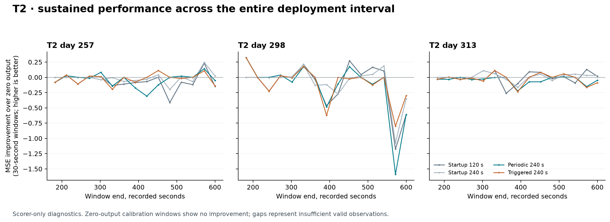

# V7B: accumulating labels and choosing when to recalibrate

**Continual recalibration did not pass any of the three predeclared fresh-data
gates.** All 24 selected sessions were retained, 22 were scorable, and all three
T2 sessions had negative R² under every learned method. The two-minute frozen
startup model had the best cohort mean R², 0.2253; periodic and triggered updates
reached 0.2008 and 0.2127 after charging their interruptions.

The mechanism result is also limiting: **70 of 71 additional requests were
forced by the schedule or quota, and only one came from the neural-shift
threshold.** That one met the retrospective false-alarm proxy, while five
below-threshold decisions followed worse-than-zero output, all in T2. These
data provide little evidence that the neural-shift score identifies when labels
will be useful. The engineering implementation is fast and reproducible, but
this calibration policy has not demonstrated reliable fresh recovery or a
cohort advantage over the shorter startup calibration.

The experiment follows a failed recovery screen. V7A's best eligible recency
method, rolling240, reached mean T2 R² **0.049538**, below the locked 0.05 floor.
Its gate remains **FAIL**. An expanding-history control reached **0.068916** and
improved all six primary T2 sessions, although one remained negative. That
control was ineligible for the original gate and used 540 unique label seconds.
It motivated a new hypothesis, not a retrospective gate pass.

The original protocol prescribed stopping after gate failure. The
[V7B amendment](CONTINUAL_PROTOCOL.md) explicitly changed that continuation rule
after exposed development outcomes, before fresh outcome preparation and
scoring. The new hypothesis retains all acquired labels and places limited
feedback opportunities in time. The unchanged
[V7A report](RECOVERY_REPORT.md), failed gate, code and artifact identities remain
available. This post-development amendment is part of the evidence history.

## Data and information boundaries

Source selection uses 152 already exposed session prefixes: 18 each from T2,
T5, T6, T7, T8, T9, T10 and T11, plus eight from T3. The 24 sessions previously
held out in V6 are development data here. They are not fresh V7 outcomes.

The fresh cohort is fixed by the [acquisition plan](acquisition-plan.json):
regular archive ranks 19–21 from each of the eight non-T3 participants, in
Dryad version 462702. The importer authenticates the previous 18 regular archive
members against their exact V6 lineage. Rank selects sessions; numeric
post-implant day determines chronological reporting. Duration, task quality and
decoding scores do not select or replace cases. At most the first 30,000 bins
of each selected recording are prepared. Missing, short or unavailable cases
remain in the inventory. T3 continuations and unexposed recording tails are
outside this study.

**Seconds throughout the scientific evaluation mean recorded observation time:**
one prepared bin is 20 ms. Wall time between acquisition blocks is unknown.
Label budgets, interruptions, trigger windows and recovery delays therefore do
not establish elapsed real-world time across recording gaps. Separate runtime
benchmarks use actual monotonic clocks and have a different timing scope.

The target is unit cursor-to-target direction on valid go pairs, an offline
intention proxy. Features combine threshold-crossing counts and spike-band
power with the unchanged causal 200 ms filter and acquisition-block resets.
The decoder fixes normalization to the first 30 recorded seconds, clips
normalized features to ±8, and uses ridge penalty 1 with a free intercept and
unit-disk output projection. A fit needs at least 50 eligible rows; otherwise
its weights are zero.

Only purchased labels can enter later fits. The controller's neural-shift
decision receives neither target direction, valid-go masks nor scorer errors.
Full inputs reside locally, so this is an API and numerical information
boundary, not filesystem isolation. Prepared trial identifiers are unavailable;
temporal separation and a two-second delay do not establish independent trials.
Upstream feature-extraction causality, acquisition latency and changes in human
behavior remain outside the claim. More detail is in [DATA.md](DATA.md).

## Fixed comparison

All five methods use the same eligible scoring bins between recorded seconds
152 and 600, truncated at the observed recording end. Each acquisition block
excludes its first 62 bins. Calibration and fitting delays remain in the common
score as zero output. Startup cost before second 152 is outside this common
prediction interval but remains included in the label accounting.

| Method | Purchased labels on a complete 600-second prefix | First deployment | Further requests | Interruption inside the common interval |
|---|---:|---:|---|---:|
| Zero output | 0 s | None | None | 0 s; output is always zero |
| Frozen120 | 120 s, seconds 30–150 | 152 s | None | 0 s |
| Fixed240 | 240 s, seconds 30–270 | 272 s | None | 120 s |
| Periodic240 | Initial 120 s plus four 30 s bursts | 152 s | Starts at 210, 330, 450 and 510 s | 128 s |
| Triggered240 | Initial 120 s plus four 30 s bursts | 152 s | Four of six fixed opportunities | 128 s |

Each additional burst has 30 recorded seconds of labels followed by a
two-second label-delay/refit allowance. The model resumes afterward using every
previously purchased eligible label; there is no decay or forgetting. The model
artifact is serialized, reloaded and checked before its predictions enter the
trace. If the recording ends before a burst and its delay finish, no unobserved
future fit is performed. Available partial labels and interruptions are still
charged.

Fixed240 is essential to interpretation: periodic240 buys twice the label
budget of frozen120. Comparing the two continual arms with fixed240 helps
distinguish collecting labels later from simply collecting more labels.
Zero output supplies the explicit operational error baseline. R² uses the
evaluated target mean as its reference, so zero output need not have R² zero.

The trigger considers starts at 210, 270, 330, 390, 450 and 510 seconds. It
compares the preceding 60-second neural feature distribution with the reference
from seconds 30–150. The score is mean diagonal-Gaussian KL divergence in the
current-to-reference direction, using the frozen standardization, clipping and
a variance floor of 0.05. A request occurs at or above the selected threshold.
It is also forced if the remaining opportunities equal the remaining burst
quota, or at least 180 recorded seconds have passed since the last probe ended.
Requests stop after four bursts. This is a way to allocate a fixed feedback
budget; distribution shift alone is not evidence that decoding has failed.

On a complete 600-second recording, periodic240 and triggered240 both purchase
exactly 240 seconds and incur 128 seconds of interruption in the common interval.
**Equal actual label budgets are guaranteed and checked only for complete
600-second cases.** On shorter recordings, request timing can change the number
of labels actually acquired. Those cases remain in all prespecified cohort
scores and cost summaries. Any whole-cohort comparison must show actual costs
and must not be described as universally matched-cost merely because the
complete-recording check passes.

## Source selection and provenance

The threshold grid was fixed at 0.1, 0.25, 0.5 and 1.0. For each target
participant, every session from that participant was excluded from ranking.
The objective was the highest equal-participant mean full-interval R² for
triggered240 among the remaining source participants. Ties use grid order.
All thresholds and all five methods were retained; there is no feasibility
fallback or fresh-outcome-based selection.

| Target participant excluded from ranking | Selected KL threshold |
|---|---:|
| T2 | 0.5 |
| T3, source analysis only | 0.5 |
| T5 | 0.25 |
| T6 | 0.5 |
| T7 | 1.0 |
| T8 | 0.5 |
| T9 | 0.5 |
| T10 | 0.5 |
| T11 | 1.0 |

T2 informed the study design before this ranking. Whole-person exclusion during
threshold selection therefore does not make T2 an untouched development
participant. The fresh assessment tests new sessions from known people. It does
not establish transfer to new participants or to a new recording system.

The source audit passed after checking 152 sessions, 3,040 method/threshold
cases, 6,741 models and 3,040 full traces. The
[public source results](../results/v7-continual-source.json),
[source audit](../results/v7-continual-source-audit.json) and
[selection artifact](../results/v7-continual-selection.json) retain the complete
candidate evidence. Source choice publication occurred in commit `53f088f`,
before fresh scoring. The assessment rejects a changed scientific source or
selection identity.

Before fresh scoring, a synthetic unit-circle diagnostic exposed a precision
mismatch: float32 targets and float64 predictions could produce a nonzero
error difference even for exact zero output. Commit `51b2f7e` promotes both
arrays to float64 before calculating either term in the descriptive diagnostic
and its independent verifier. Regression tests require exact zero difference
and neutral classification. This correction did not change the diagnostic
definition, tolerance, policy, primary scorer or gates. The 14 frozen scientific
producer and data-dependency files retained their source-selection hashes.

| Locked artifact | SHA256 |
|---|---|
| Continual plan | `4f88a6cf98dd7147691f4eaf64143784736863e1cfa4fd5fbd7b3fadd1eaea23` |
| Exposed development index | `4b2c0c8b47a2caf1a2135b28dcea197a26c8f6006c19f243ff2fed23c5e1362e` |
| Source manifest | `956b455f3a2f6b971cddd72dd32b7a352c94f158573c1475b3f29c2f07665639` |
| Bound private source audit receipt | `f7744991125e5ae55a37d099414777aaf44885d5b86acb53d09dbd100b289796` |
| Published threshold selection | `25a046b567b4f89f9940a9971b231e89d3a9cf1e26f09dcf4ad33bfa4f0bb157` |

Hashes establish exact artifact identity. The separate audit verifies their
relationship to the data, implementation and numerical results. The compact
public source-audit file omits duplicated selection and summary payloads and
therefore has a different digest from its bound original receipt.

## Fresh outcomes and decisions

The [audited study aggregate](../results/v7-continual-study.json) contains all
24 requested sessions. Twenty-two were scorable under each method. T6 days
1153 and 1158 ended at 141.96 and 128.48 recorded seconds, before the common
152-second deployment boundary; they were retained with unavailable scores and
their partial label costs. T6's remaining session supplies its one scorable
result. There were 17 complete 600-second prefixes and seven shorter cases.

Session R² pools the common eligible bins; it does not average window R².
Cohort means first average scorable sessions within each participant, then give
all eight participants equal weight. Intervals use 10,000 bootstrap draws:
sessions for primary T2 and participants for cohort comparisons. Three T2
sessions provide limited uncertainty resolution; repeated bins and windows do
not increase the independent sample count. Cost means retain every selected
session, including those without a score.

| Method | Cohort mean R² [participant 95% interval] | Positive participant means | Mean actual label seconds | Mean interruption seconds |
|---|---:|---:|---:|---:|
| Zero output | −0.0340 [−0.0499, −0.0215] | 0/8 | 0.00 | 0.00 |
| Frozen120 | **0.2253 [0.1008, 0.3426]** | 7/8 | 118.77 | 0.00 |
| Fixed240 | 0.1617 [0.0501, 0.2659] | 6/8 | 225.62 | 106.77 |
| Periodic240 | 0.2008 [0.0929, 0.2858] | 7/8 | 211.27 | 98.66 |
| Triggered240 | 0.2127 [0.1081, 0.3009] | 7/8 | 207.52 | 94.66 |

The frozen startup decoder had the highest cohort mean despite buying fewer
labels. Triggered240 exceeded periodic240 by 0.0118 mean R², but the paired
interval crossed zero. These observations do not support a general accuracy
benefit from continual updates under the tested interruption assumption.


### Every participant

| Participant | Scorable / selected | Frozen120 R² | Fixed240 R² | Periodic240 R² | Triggered240 R² |
|---|---:|---:|---:|---:|---:|
| T2 | 3/3 | −0.0860 | −0.0545 | −0.1066 | −0.0777 |
| T5 | 3/3 | 0.3446 | 0.0872 | 0.2912 | 0.3446 |
| T6 | 1/3 | 0.0611 | −0.0784 | 0.0611 | 0.0611 |
| T7 | 3/3 | 0.1228 | 0.1602 | 0.2183 | 0.1946 |
| T8 | 3/3 | 0.4385 | 0.3391 | 0.3266 | 0.3297 |
| T9 | 3/3 | 0.3234 | 0.2642 | 0.2612 | 0.2771 |
| T10 | 3/3 | 0.4315 | 0.3561 | 0.3290 | 0.3394 |
| T11 | 3/3 | 0.1666 | 0.2198 | 0.2259 | 0.2324 |

Periodic updates improved the participant means for T7 and T11 relative to
frozen120, while degrading five others and leaving T6 unchanged. Triggering
improved on periodic scheduling in six participant means, degraded T7 and left
T6 unchanged, but its cohort advantage was uncertain. Positive decoding in
seven participant means should not obscure the persistent failure in T2.

### T2 remains unrecovered

All three primary sessions were complete 600-second prefixes, so the three
240-second methods had equal actual label budgets here. None produced positive
session R². Fixed240 was the best learned T2 mean; periodic updates were worse
than that comparator in all three sessions.

| T2 day | Zero output | Frozen120 | Fixed240 | Periodic240 | Triggered240 |
|---|---:|---:|---:|---:|---:|
| 257 | −0.0055 | −0.0747 | −0.0159 | −0.0432 | −0.0256 |
| 298 | −0.0058 | −0.1272 | −0.1040 | −0.1726 | −0.1273 |
| 313 | −0.0531 | −0.0562 | −0.0435 | −0.1041 | −0.0801 |
| **Mean** | **−0.0215** | **−0.0860** | **−0.0545** | **−0.1066** | **−0.0777** |

Triggered240 improved over periodic240 in all three T2 sessions, with mean gain
0.0289 and paired session interval [0.0176, 0.0453]. That relative improvement
did not restore useful absolute accuracy: all three triggered and periodic
sessions had greater full-interval MSE than zero output. Fixed240 beat zero MSE
on day 313 despite its negative R², illustrating the distinction between these
two reference comparisons.



### Paired comparisons and locked gates

| Contrast | Cohort mean R² gain [paired participant 95% interval] | T2 mean gain [paired session 95% interval] |
|---|---:|---:|
| Periodic240 − frozen120 | −0.0245 [−0.0703, 0.0234] | −0.0206 [−0.0480, 0.0315] |
| Periodic240 − fixed240 | 0.0391 [−0.0137, 0.1024] | −0.0522 [−0.0686, −0.0273] |
| Triggered240 − periodic240 | 0.0118 [−0.0021, 0.0269] | 0.0289 [0.0176, 0.0453] |
| Triggered240 − frozen120 | −0.0126 [−0.0560, 0.0294] | 0.0084 [−0.0240, 0.0491] |

| Predeclared gate | Observed decision and limiting criteria |
|---|---|
| Periodic T2 recovery | **FAIL.** All three were scorable, but mean R² was −0.1066 instead of at least 0.05; 0/3 were positive instead of at least two; gain over frozen120 was −0.0206 instead of at least 0.05, and its paired interval included zero. |
| Periodic cohort gain | **FAIL.** All eight people were scorable, but gain over frozen120 was −0.0245 instead of at least 0.02, and its paired interval included zero. |
| Additional value of triggering | **FAIL.** Complete-recording budgets matched, mean cohort gain exceeded 0.01, and T2 was no worse than periodic240. The paired cohort lower endpoint was −0.0021, below the required positive value. |

The numerical audit passed; all scientific success gates failed. Neither
relative T2 improvement over a weaker continual comparator nor rounding the
cohort interval changes these decisions.

### Actual costs and the fixed240 comparison

The common planned 240-second cap does not make actual costs equal on short
recordings. All 17 complete prefixes matched at 240 acquired seconds for
fixed240, periodic240 and triggered240. The seven shorter cases are shown below;
all durations count recorded observation time.

| Session | Observed seconds | Frozen120 labels | Fixed240 labels | Periodic240 labels / interruption | Triggered240 labels / interruption |
|---|---:|---:|---:|---:|---:|
| T5 day 1671 | 328.66 | 120.00 | 240.00 | 150.00 / 32.00 | 120.00 / 0.00 |
| T5 day 1743 | 307.66 | 120.00 | 240.00 | 150.00 / 32.00 | 120.00 / 0.00 |
| T5 day 1804 | 317.40 | 120.00 | 240.00 | 150.00 / 32.00 | 120.00 / 0.00 |
| T6 day 1151 | 194.38 | 120.00 | 164.38 | 120.00 / 0.00 | 120.00 / 0.00 |
| T6 day 1153, unscorable | 141.96 | 111.96 | 111.96 | 111.96 / 0.00 | 111.96 / 0.00 |
| T6 day 1158, unscorable | 128.48 | 98.48 | 98.48 | 98.48 / 0.00 | 98.48 / 0.00 |
| T9 day 259 | 481.84 | 120.00 | 240.00 | 210.00 / 95.84 | 210.00 / 95.84 |

For all three T5 recordings, triggered240 acquired no labels after startup,
incurred no interruption and produced the frozen120 output. Periodic240 acquired
one extra burst and incurred 32 seconds of interruption. The T5 gain of 0.0533
over periodic240 therefore accompanies a different actual budget and timing,
not evidence that a neural-shift alarm repaired the decoder. T6's only scorable
session ended before any continual probe or fixed240 deployment; the continual
outputs equal frozen120, while fixed240 remains zero.

**Post-assessment descriptive sensitivity analysis:** restricting the existing
audited rows to the 17 complete prefixes leaves six participants, excluding T5
and T6 and retaining two T9 sessions. Equal-participant means are fixed240
0.2159, periodic240 0.2094 and triggered240 0.2172. At these equal actual label
budgets, periodic240 − fixed240 is −0.0066, rather than the full-cohort +0.0391.
This subgroup calculation uses no new fits or selection and has no new success
gate. It illustrates why the main whole-cohort contrast cannot be described as
an unconditional matched-actual-cost advantage. It does not replace any
prespecified full-cohort result.

## Monitoring diagnostics and their limits

The [diagnostic aggregate](../results/v7-continual-diagnostics.json) and
[independent diagnostic audit](../results/v7-continual-diagnostics-audit.json)
retain all 120 session-method outcomes and 113 decisions. Their definitions
were fixed before scoring, and none of these evaluator-only measurements
entered the controller or changed a threshold.

### The neural-shift signal mostly did not request labels

There was **one neural-threshold request and 70 forced requests**. The lone
threshold request occurred in T11 day 126 at 210 seconds. Its preceding active
interval was already better than zero output by 0.0702 summed MSE, so it met
the prespecified false-alarm proxy. This is one observed request, not a reliable
estimate of an operational false-positive rate or evidence that the later
labels had no value.

Of 42 assessable below-threshold decisions, five followed active output worse
than zero. All five were in T2: day 257 at 210 and 270 seconds, day 298 at 270
seconds, and day 313 at 210 and 270 seconds. These are missed requests under the
retrospective error proxy, not five independent biological drift events. The
controller cannot observe those scorer errors. Together with the forced-request
dominance, they show that this KL signal has not demonstrated useful sensitivity
to the failure mode we wanted it to detect.

### Worse-than-zero windows are not active-control recovery

The harmful-window statistic counts valid rows belonging to eligible
30-second windows whose summed MSE exceeds zero output. The cohort rate below
averages the eight participant rates equally. Session counts compare each full
session's MSE with zero.

| Method | Worse-than-zero sessions / 22 | Cohort harmful-window valid-time fraction | T2 harmful-window fraction |
|---|---:|---:|---:|
| Frozen120 | 4/22 | 12.48% | 57.02% |
| Fixed240 | 2/22 | 5.37% | 33.75% |
| Periodic240 | 3/22 | 7.86% | 55.48% |
| Triggered240 | 3/22 | 6.63% | 47.84% |

Frozen120's worse-than-zero sessions were all three T2 recordings and T11 day
1282. Both continual methods retained all three T2 failures; fixed240 retained
T2 days 257 and 298. Lower harmful-window fractions do not establish superior
active control or safety. Zero-output calibration pauses are neutral against
this baseline and can reduce time classified as worse than zero while still
reducing useful prediction time. Indeed, the continual methods had lower cohort
fractions but also lower full-interval R² than frozen120. The scored interruption
cost and accuracy comparison must remain alongside this diagnostic.

### Resolved and censored episodes

A retrospective recovery episode starts with a worse-than-zero 30-second
window and ends at the end of a later strictly better window. Neutral calibration
windows do not establish recovery. The delay includes the observation time
needed to classify the recovery window. Unresolved episodes are right-censored
at the recording end.

| Method | Resolved episodes | Right-censored episodes | Mean delay among resolved episodes, recorded seconds |
|---|---:|---:|---:|
| Zero output | 0 | 0 | Unavailable |
| Frozen120 | 16 | 5 | 90.00 |
| Fixed240 | 8 | 2 | 93.75 |
| Periodic240 | 8 | 3 | 135.00 |
| Triggered240 | 12 | 3 | 87.50 |

Triggered240's shorter resolved-episode mean than periodic240 is descriptive.
Episode populations differ, unresolved episodes are excluded from that mean,
and recovery can occur without an update, as the frozen120 row demonstrates.
For example, T2 day 298 still ended with an unresolved triggered episode of
238 recorded seconds. No causal benefit of labels, exact onset of drift or
independent episode-level replication follows from these averages.

## What the fresh evidence supports

The accumulating-label control in V7A justified a hypothesis worth testing,
but its dense, exposed-data benefit did not translate into reliable T2 recovery
with sparse feedback and charged interruptions. The failure of the neural
trigger is distinct: it seldom fired, missed several T2 error proxies and
mostly behaved as a forced schedule. Better coefficient maintenance alone
cannot fix an uninformative acquisition signal or an inadequate representation.

The defensible next design question is whether task and target coverage,
representation quality or an observable measure of prospective label benefit
can explain T2's failure while preserving useful decoding elsewhere. Those are
hypotheses for a separately locked study, not conclusions established here.
The current results do not demonstrate reduced daily calibration, safe failure
detection, closed-loop benefit or transfer to untouched participants. All fresh
sessions in this report are now exposed evidence for future development.

The [fresh numerical audit](../results/v7-continual-assessment-audit.json) checked
24 sessions, 120 method cases, 230 models, 120 full traces and 708 events. Maximum
prediction disagreement was 1.22 × 10⁻¹⁴; the maximum relative ridge-equation
residual was 6.33 × 10⁻¹⁵. The separate diagnostic audit verified episode
censoring and request classifications. These checks establish implementation
fidelity, not a successful scientific outcome.

## Engineering evidence has a separate role

The [engineering report](ENGINEERING.md) establishes source-only numerical and
compute properties. Two 60-second paced replays had zero deadline misses across
6,000 predictions, with release-to-completion p99 below 5.57 ms. A bounded-state
ridge accumulator reproduced all five declared source fits while retaining
302,624 bytes of persistent numeric calibration state. It distributes statistics
updates over incoming labels and leaves the policy's label budget unchanged.

These checks do not contribute fresh efficacy evidence. The final source model
uses labels acquired later than much of its replayed prefix, so the full-prefix
outputs are only compute and parity tests. The scientific two-second refit
allowance is an assumption assessed by separate measurements on one workload,
not a worst-case realtime guarantee. The original ambient-load annotation and
timing limitations remain in [RUNTIME_REPORT.md](RUNTIME_REPORT.md).

## Reproduction and evidence identity

The [reproduction guide](README.md) contains the acquisition, source ranking,
assessment, publication and engineering commands. Use the existing Python
environment; no Rust compilation is needed. Every run directory is immutable,
and raw samples, coefficients and full predictions remain local. Audited source
choices must be published before fresh scoring. Independently rebuilt inputs
and choices have their own verified hashes; the original selection digest is
recorded above.

The final independent checks can be reproduced against the retained artifacts
with new receipt paths:

```sh
export PYTHONPATH="$PWD/src:$PWD"
export OPENBLAS_NUM_THREADS=1 OMP_NUM_THREADS=1 VECLIB_MAXIMUM_THREADS=1
.venv/bin/python -m neural_experiments.v7.audit_continual \
  --run results/neural_v7/continual-assessment \
  --source-run results/neural_v7/continual-source \
  --source-audit results/neural_v7/continual-source-audit.json \
  --output results/neural_v7/assessment-audit-reproduction.json
.venv/bin/python -m neural_experiments.v7.audit_diagnostics_continual --help
```

The fresh index SHA256 is
`34f51825b1f1b4b7f8144fcfe93822f61295a2a013f0cd564fff610228d20e47`;
the complete assessment manifest SHA256 is
`7cb36ddfb0d255ba2d02068fe369046d51232ad8fc800b969c3f041b21465267`.
The linked public numerical and diagnostic receipts bind these identities to
the exact published aggregates.

The audit independently reconstructs fits, trigger decisions, deployed traces,
scores, costs, threshold ranking and gate arithmetic, and authenticates the
fixed fresh cohort. This is an independent implementation within the project,
not external replication. A numerical audit pass means the results match the
declared computation; it does not mean the scientific success gates passed.
